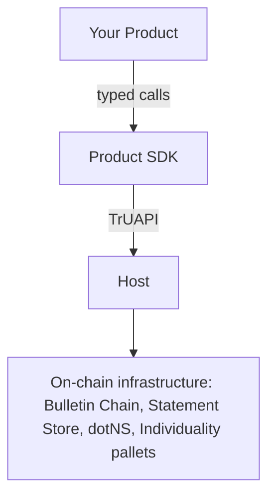

# App Development Reference

## Introduction

This is the technical-depth companion to the [App Development](/apps/) how-to guides. Where the guides walk you through tasks step by step, this section explains _what each component is, how it works, and where its limits are_: the level of detail you need when integrating against the surface, or when implementing a Host.

A Polkadot Product is a sandboxed application that runs inside a Host. The Product reaches everything sensitive, including signing, chain access, storage, and outbound requests, through one protocol, TrUAPI. This reference covers the software on each side of that boundary: the protocol itself, the [Product SDK](/apps/product-sdk/) that wraps it, and the on-chain infrastructure components Products consume.

!!! info "Depth target"
    Each page in this section follows the same shape: a short conceptual frame up top, then the developer-facing surface (method groups and Host requirements for the protocol, pallet surface tables for infrastructure) below. The [TrUAPI](/apps/reference/protocol/truapi/) subsection, with one page per method group, is the depth model for protocol reference pages.

## Architecture

Your Product sits at the top of a layered stack:

- **Product**: The application you write. It never holds the user's keys, and it reaches chains and storage only through the Host.
- **[Product SDK](/apps/product-sdk/)**: The `@parity/product-sdk` family of TypeScript packages. Each package wraps one or more TrUAPI method groups in typed methods that return a `Result`.
- **[TrUAPI](/apps/reference/protocol/truapi/)**: The protocol between a Product and its Host. It defines the method groups, the permission model, and what a Host must guarantee for each call.
- **[Host](/get-started/glossary/#host)**: Any application that loads Products, enforces the sandbox, and implements TrUAPI. The Host holds or reaches the user's keys, prompts the user for anything sensitive, and routes calls to the chains and services below. Any Host, whoever builds it, implements the same protocol.
- **Infrastructure**: The on-chain components Products read from and write to through the Host.

## Protocol

The [TrUAPI](/apps/reference/protocol/truapi/) reference documents the contract between Hosts and Products: the sandbox and sub-account model, the 11 method groups (TrUAPI Calls, Permissions, Local Storage, Account Management, Signing, Chat, Statement Store, Preimage, Chain Interaction, Payment, Entropy), the versioning model, and the package map.

Each method-group page serves two readers. Product developers learn what a call does and which SDK package wraps it. Host implementers find a Host Requirements section stating what their Host must enforce, and the TrUAPI overview collects the [Host Implementation Notes](/apps/reference/protocol/truapi/#host-implementation-notes) that cut across groups.

## Product SDK

The [Product SDK](/apps/product-sdk/) pages document each package: [Signer](/apps/product-sdk/signer/), [Chain Client](/apps/product-sdk/chain-client/), [Transactions](/apps/product-sdk/tx/), [Local Storage](/apps/product-sdk/local-storage/), [Cloud Storage](/apps/product-sdk/cloud-storage/), [Statement Store](/apps/product-sdk/statement-store/), [Contracts](/apps/product-sdk/contracts/), [Individuality](/apps/product-sdk/individuality/), and the lower-level [Host](/apps/product-sdk/host/) package. The [Packages](/apps/reference/protocol/truapi/packages/) page maps each package to the TrUAPI method group it wraps.

## Infrastructure

Per-component reference for the on-chain infrastructure Products consume:

- **[Bulletin Chain](/apps/reference/infrastructure/bulletin-chain/)**: Content-addressed storage with explicit authorization, chunked uploads, time-bound retention, and renewal.
- **[Statement Store](/apps/reference/infrastructure/statement-store/)**: Gossip-distributed, signed statements for real-time signaling between users.
- **[dotNS](/apps/reference/infrastructure/dotns/)**: The `.dot` name system, including PopRules pricing, the contract architecture, and the registration flow.
- **[Proof of Personhood](/apps/reference/infrastructure/pop/)**: The Ring-VRF mechanism and the Individuality pallets (people, game, score, identity, universal basic capacity, coinage).
- **[HOP](/apps/reference/infrastructure/hop/)**: The Hand-Off Protocol for delivering ephemeral, addressed data between users.

## Where to Go Next

- Learn **TrUAPI**

    ---

    Start with the protocol every Product and Host speaks: the sandbox model, the method groups, and the Host requirements.

    [:octicons-arrow-right-24: Reference](/apps/reference/protocol/truapi/)

- Learn **playground CLI**

    ---

    Look up every `pg` command and flag for building, deploying, and managing Products from the terminal.

    [:octicons-arrow-right-24: Reference](/apps/playground-cli/)

- Guide **App Development How-To**

    ---

    If you are new here, start with the how-to guides: set up a Host, then build your first Product against the SDK surface this reference documents.

    [:octicons-arrow-right-24: Get Started](/apps/get-started/)

