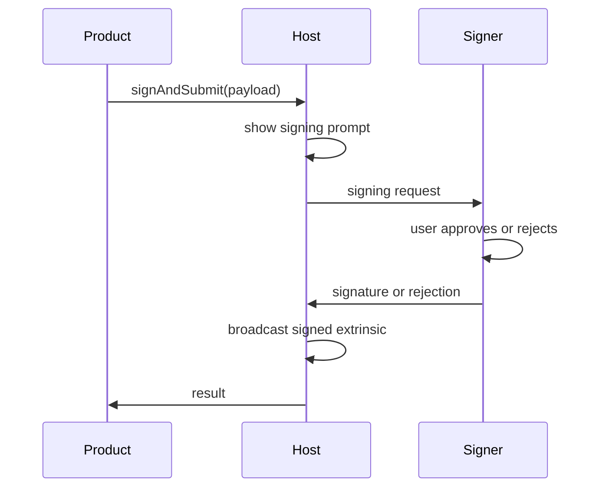

# Signing

## Introduction

The Signing method group lets a Product get a transaction or payload signed by the user's account. The Product never holds the key. The Host mediates: it shows the user what they are about to sign, obtains the signature from wherever the key lives, and returns the result as a signature, a rejection, or a timeout.

The Product SDK wraps this as `tx.signAndSubmit(signer)` on a Polkadot API (PAPI) transaction object plus a signer returned by `SignerManager.getSigner()`. From the Product's perspective, it is a single awaited promise. Underneath, it is a TrUAPI dispatch and, usually, a round trip to the user's signing device.

## The Three-Actor Model

A signing operation involves three roles:

- **Product**: Builds the transaction and calls `signAndSubmit` through [`@parity/product-sdk-signer`](/apps/product-sdk/signer.md) or directly through TrUAPI.
- **Host**: Receives the encoded payload, shows the user a signing prompt, forwards the request to the signer, and broadcasts the signed extrinsic.
- **Signer**: Holds the key, asks the user to approve or reject, and returns the signature. The signer can be a separate paired device, such as the Polkadot App on the user's phone, or part of the Host itself.

Your Product code awaits a single promise for this entire round trip.

## Conceptual Contract

The group covers:

- **Submitting a payload for signing**: The Product hands the Host a pre-built, account-bound transaction. The Host shows the signing prompt and forwards the payload to the signer.
- **Watching the result**: The Host returns the outcome: signature obtained (the Host then broadcasts), explicit user rejection, or session timeout.
- **Surfacing status transitions**: Through PAPI's `submitAndWatch` companion surface, the Product sees status events (`signing`, `broadcasting`, `in-block`, and `finalized`) as the transaction progresses.

In the [`@parity/truapi`](https://www.npmjs.com/package/@parity/truapi) client, the `signing` domain exposes `createTransaction` for product accounts, `signPayload` and `signRaw`, and legacy-account variants (`createTransactionWithLegacyAccount`, `signPayloadWithLegacyAccount`, and `signRawWithLegacyAccount`).

## `ChainSubmit` Grants the Ability to Ask

The [`ChainSubmit`](/apps/reference/protocol/truapi/permissions.md#remote-operation-permissions) permission does not authorize the Host to sign on the user's behalf. It authorizes the Product to _request_ that a signing prompt be shown:

- Without `ChainSubmit`, the Product cannot ask. The Host rejects the signing request with `PermissionDenied`.
- With `ChainSubmit`, the Product can ask, and each request is confirmed by the user individually. Two consecutive transactions produce two prompts.

The `signer` package requests `ChainSubmit` automatically after `connect()`.

## `AutoSigning`

Per-request confirmation is the default. The only exception the protocol defines is the `AutoSigning` resource. A Product requests it through resource allocation (the `requestResourceAllocation` callback in the `signer` package's `onConnect` hook), and the user must grant it. When an `AutoSigning` grant covers an account, the Host serves `createTransaction`, `signPayload`, `signRaw`, and `signVrf` for that account without a per-call confirmation. Without the grant, every call is confirmed by the user.

The allocation resolves to `Allocated`, `Rejected`, or `NotAvailable`. See [Allowances and Permissions](/apps/concepts/allowances.md) for its scope and lifetime.

!!! warning "Provisional"
    The guides report that both the Android and iOS wallets return `NotAvailable` for `AutoSigning` today, and this reference cannot confirm that any Host grants it. Treat per-request signing as the real path and do not build a flow that depends on `AutoSigning` being granted.

## Failure Modes

Signing is asynchronous, because the user may approve on another device. Two failure modes are first-class, and the Product SDK surfaces each as a typed error:

- **User rejection** (`HostRejectedError`): The user dismissed the prompt. Treat it like a cancellation: return the user to a stable UI state and let them retry.
- **Session timeout** (`TimeoutError`): The signing session expired before the user responded. Handle it the same way as a rejection.

Do not freeze your interface during a signing request. Show a non-blocking pending state, and make your retry path idempotent in case the user attempts the same action twice. For the `try`/`catch` pattern, see [Sign and Submit Transactions](/apps/build/sign-and-submit.md).

## Host Requirements

A Host implementing this method group must:

- **Never expose the key**: The Product receives only signatures or signed extrinsics, never key material.
- **Show what is being signed**: Before forwarding a request, show the user the network, the transaction type (for example, a balances transfer), the call arguments, and an estimated fee, with a way to inspect the encoded call data.
- **Confirm every request**: Require a fresh user confirmation for each signing request, unless an `AutoSigning` grant covers the account.
- **Gate on `ChainSubmit`**: Reject signing requests with `PermissionDenied` when the Product does not hold `ChainSubmit`.
- **Bound the session**: Time-limit each request, tell the user how long remains, and return a timeout when it expires.
- **Report every outcome**: Return a distinct rejection or timeout to the Product, and on approval broadcast the signed extrinsic and report its status.

!!! warning "Provisional"
    Edge cases still being defined include multi-signature flows that aggregate across multiple Hosts, batched transactions that present as a single user prompt, and custom signing policies (delegation, time-windowed allowances). The single-transaction, single-prompt contract described on this page is stable.

## Where to Go Next

- Guide **Sign and Submit Transactions**

    ---

    The Product-side how-to with the `try`/`catch` patterns for `HostRejectedError` and `TimeoutError`.

    [:octicons-arrow-right-24: Get Started](/apps/build/sign-and-submit.md)

- Learn **Permissions**

    ---

    The `ChainSubmit` permission and the rest of the permission set the Host enforces.

    [:octicons-arrow-right-24: Reference](/apps/reference/protocol/truapi/permissions.md)

