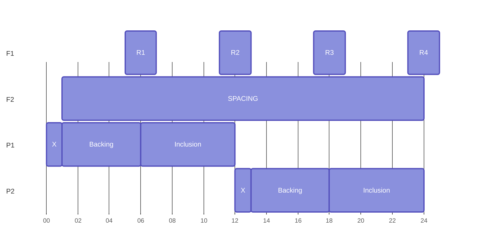
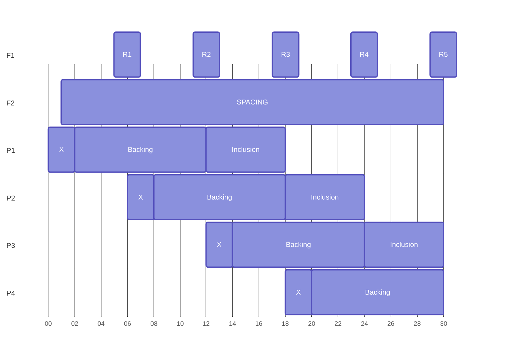

# Asynchronous Backing

## Introduction

Asynchronous backing (async backing) lets parachain collators build blocks on top of parent blocks that the relay chain has not yet included. This decouples parachain block production from relay chain inclusion, so a parachain can produce a block every 6 seconds instead of every 12 seconds and spend up to 2 seconds of execution on each block instead of 0.5 seconds.

On the Polkadot SDK side, async backing is a combination of runtime configuration (a consensus hook and Aura settings) and a collator that builds ahead of the relay chain. The [parachain template](https://github.com/paritytech/polkadot-sdk/tree/{{dependencies.repositories.polkadot_sdk.version}}/templates/parachain) has async backing enabled. This page explains how it works and which settings the template uses. For step-by-step instructions on upgrading an older parachain, see the [Upgrade Parachain for Asynchronous Backing Compatibility](https://paritytech.github.io/polkadot-sdk/master/polkadot_sdk_docs/guides/async_backing_guide/index.html) guide in the Polkadot SDK Docs.

## Synchronous vs. Asynchronous Processing

In the original synchronous mode, collators and validators drew context only from the relay parent of the prior parablock. The generation and backing steps for a new parablock could only start once the prior parablock had gone through the whole [inclusion pipeline](/polkadot-sdk/reference/consensus/index.md#inclusion-pipeline). As a result, one parablock could be processed every other relay chain block, with 0.5 seconds of execution time.



With async backing, collators and validators also use the unincluded segment as context. The unincluded segment is the chain of parablocks that collators have built but that the relay chain has not yet included. The prior parablock only needs to complete generation and join the unincluded segment before the next parablock can start generation and backing.

This results in one parablock being processed every relay chain block instead of every other relay chain block, and allows more execution time during generation (2 seconds instead of 0.5 seconds).


## Runtime Configuration

The runtime limits how far ahead of the relay chain collators can build. The template runtime defines three constants in `runtime/src/lib.rs` and passes them to the [`FixedVelocityConsensusHook`](https://paritytech.github.io/polkadot-sdk/master/cumulus_pallet_aura_ext/consensus_hook/struct.FixedVelocityConsensusHook.html) from `cumulus_pallet_aura_ext`:

```rust
mod async_backing_params {
	/// Maximum number of blocks simultaneously accepted by the Runtime, not yet included
	/// into the relay chain.
	pub(crate) const UNINCLUDED_SEGMENT_CAPACITY: u32 = 3;
	/// How many parachain blocks are processed by the relay chain per parent. Limits the
	/// number of blocks authored per slot.
	pub(crate) const BLOCK_PROCESSING_VELOCITY: u32 = 1;
	/// Relay chain slot duration, in milliseconds.
	pub(crate) const RELAY_CHAIN_SLOT_DURATION_MILLIS: u32 = 6000;
}
pub(crate) use async_backing_params::*;

/// Aura consensus hook
type ConsensusHook = cumulus_pallet_aura_ext::FixedVelocityConsensusHook<
	Runtime,
	RELAY_CHAIN_SLOT_DURATION_MILLIS,
	BLOCK_PROCESSING_VELOCITY,
	UNINCLUDED_SEGMENT_CAPACITY,
>;
```

- **`UNINCLUDED_SEGMENT_CAPACITY`**: The maximum number of parachain blocks the runtime accepts that are not yet included in the relay chain.
- **`BLOCK_PROCESSING_VELOCITY`**: The maximum number of parachain blocks authored per relay chain parent. The hook rejects blocks produced faster than this.
- **`RELAY_CHAIN_SLOT_DURATION_MILLIS`**: The relay chain slot duration, used to check that the parachain slot is aligned with the relay chain slot.

The template then sets the following items:

- **`cumulus_pallet_parachain_system::Config`**: `ConsensusHook` is set to the hook above, and `CheckAssociatedRelayNumber` is set to `RelayNumberMonotonicallyIncreases`.
- **`pallet_aura::Config`**: `AllowMultipleBlocksPerSlot` is set to `ConstBool<true>`, and `SlotDuration` is set to `ConstU64<SLOT_DURATION>`, with `SLOT_DURATION` equal to `MILLI_SECS_PER_BLOCK` (6000 ms in the template).
- **`AuraUnincludedSegmentApi`**: The runtime implements [`cumulus_primitives_aura::AuraUnincludedSegmentApi`](https://paritytech.github.io/polkadot-sdk/master/cumulus_primitives_aura/trait.AuraUnincludedSegmentApi.html). Its `can_build_upon` function lets the collator ask the runtime whether it may build on a given unincluded parent.
- **`MAXIMUM_BLOCK_WEIGHT`**: The block weight allows 2 seconds of compute (`WEIGHT_REF_TIME_PER_SECOND.saturating_mul(2)`) per block.

With a capacity of 3 and a velocity of 1, one parachain block is authored per relay chain block, which gives a 6-second parachain block time.

## Collator Configuration

The template node starts the [`lookahead`](https://paritytech.github.io/polkadot-sdk/master/cumulus_client_consensus_aura/collators/lookahead/index.html) collator from `cumulus_client_consensus_aura` in its `start_consensus` function in `node/src/service.rs`, with an `authoring_duration` of 2000 ms. The lookahead collator looks ahead of the most recently included parachain block when choosing a parent, and builds additional blocks while the unincluded segment is not full.

`polkadot-omni-node` uses the same collator by default. Its [`--authoring`](https://paritytech.github.io/polkadot-sdk/master/polkadot_omni_node_lib/cli/enum.AuthoringPolicy.html) option defaults to `lookahead`, which the CLI help describes as the default for asynchronous backing chains. Chains that use more than one core switch to `slot-based`, as described in [Elastic Scaling](/polkadot-sdk/reference/consensus/elastic-scaling.md).

## Relay Chain Requirements

The relay chain must also have async backing enabled. When you run a local relay chain, for example with [Zombienet](/tools/zombienet.md), check that the relay chain configuration sets `scheduler_params.lookahead` to at least `3`:

```json
"scheduler_params": {
    "lookahead": 3
}
```

With a lower value, parachain block times degrade to worse than synchronous backing. The relay chain's [`AsyncBackingParams`](https://paritytech.github.io/polkadot-sdk/master/cumulus_primitives_core/relay_chain/struct.AsyncBackingParams.html) (`max_candidate_depth` and `allowed_ancestry_len`) no longer need to be configured explicitly, and async backing works with their default values of `0`. On a live relay chain these values are part of the relay chain configuration; see the [Parachains](https://wiki.polkadot.com/learn/learn-parachains/) page on the Polkadot Wiki for protocol background.

## Where to Go Next

<div class="grid cards" markdown>

-   <span class="badge learn">Learn</span> __Parachain Consensus__

    ---

    See how the Cumulus collator builds and submits blocks and how the inclusion pipeline works.

    [:octicons-arrow-right-24: Parachain Consensus](/polkadot-sdk/reference/consensus/index.md)

-   <span class="badge learn">Learn</span> __Elastic Scaling__

    ---

    Configure the slot-based collator and the runtime to produce blocks on more than one core.

    [:octicons-arrow-right-24: Elastic Scaling](/polkadot-sdk/reference/consensus/elastic-scaling.md)

</div>
