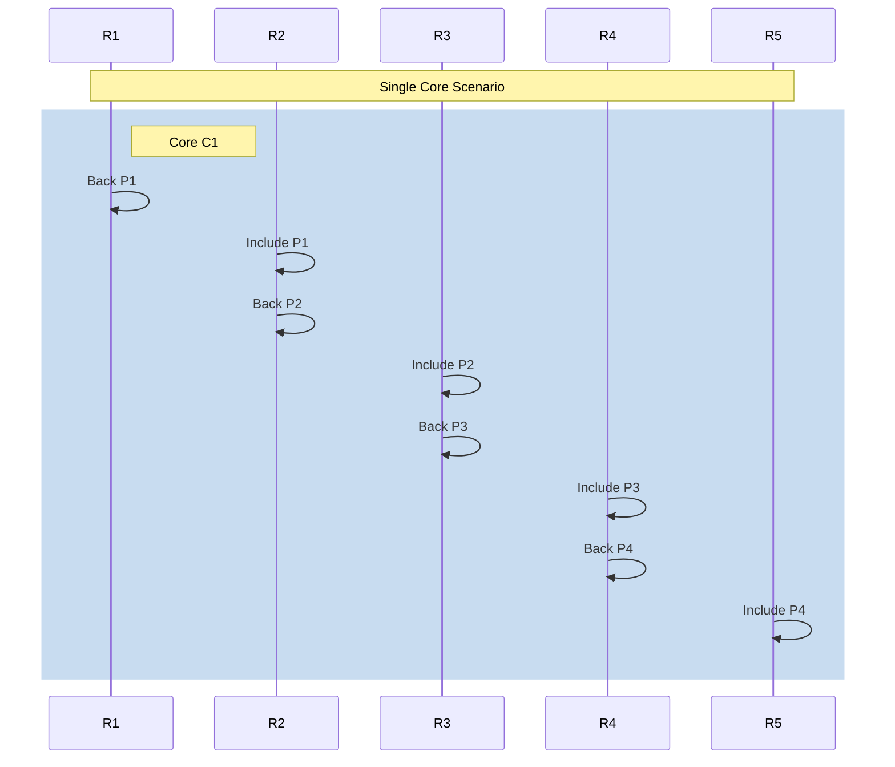
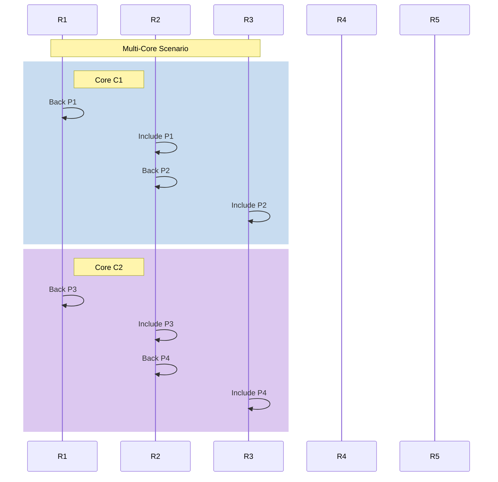

# Elastic Scaling

## Introduction

Elastic scaling lets a parachain use more than one relay chain core at the same time. Instead of one parachain block per relay chain block, collators produce several blocks per relay chain block, and the relay chain backs and includes them on different cores in parallel. More cores give a parachain more total execution time, more data availability bandwidth, and shorter block times.

Elastic scaling builds on [asynchronous backing](/polkadot-sdk/reference/consensus/async-backing/). On the Polkadot SDK side, it requires the slot-based collator and a few runtime settings, described on this page. The parachain must also be assigned the extra cores on the relay chain; core assignment is a network process covered by [Agile Coretime](https://developers.polkadot.com/reference/polkadot-hub/consensus-and-security/agile-coretime/) on the Polkadot developer site. The SDK does not acquire cores automatically.

For the full upgrade procedure, see the [Enable Elastic Scaling for a Parachain](https://paritytech.github.io/polkadot-sdk/master/polkadot_sdk_docs/guides/enable_elastic_scaling/index.html) guide in the Polkadot SDK Docs, which this page follows.

## How Elastic Scaling Works

Consider a parachain that needs to process four consecutive parablocks. With one core, each parablock is backed in one relay chain block and included in the next, so the parablocks are processed one after another.

The diagrams use the following notation:

- **R1, R2, ...**: Relay chain blocks, produced at intervals of about 6 seconds.
- **P1, P2, ...**: Parachain blocks that need validation and inclusion.
- **C1, C2, ...**: Cores on the relay chain.

With a single core, processing four parablocks takes about 30 seconds:



With two cores, the same four parablocks take about 18 seconds:



The relay chain treats the parablocks on each core as independent units during backing, availability, and approval. During inclusion, it checks that their state roots chain together, so the parachain keeps a single sequential history even though its blocks are validated in parallel.

On the parachain side, block authoring stays sequential: a collator can only build the next block after it has imported the previous one. To fill several cores, collators must produce blocks at a higher rate, which is what the slot-based collator and the runtime settings below enable.

## Requirements

The Polkadot SDK guide lists the following requirements for elastic scaling:

- Polkadot SDK `2509` or newer.
- A collator running `polkadot-omni-node` or `polkadot-parachain` with the slot-based collator.
- Upward message passing (UMP) signal support, which protects against PoV replay attacks as described in [RFC-0103](https://github.com/polkadot-fellows/RFCs/blob/main/text/0103-introduce-core-index-commitment.md). UMP signals are enabled by default in `cumulus_pallet_parachain_system`.
- A relay parent offset, so that relay chain forks do not degrade block times. See the [Handling Parachain Forks](https://paritytech.github.io/polkadot-sdk/master/polkadot_sdk_docs/guides/handling_parachain_forks/index.html) guide.
- Block production settings in the runtime that allow more than one block per relay chain block.

## Collator Configuration

Run collators with the `--authoring slot-based` option. The [`AuthoringPolicy`](https://paritytech.github.io/polkadot-sdk/master/polkadot_omni_node_lib/cli/enum.AuthoringPolicy.html) help text describes the [slot-based collator](https://paritytech.github.io/polkadot-sdk/master/cumulus_client_consensus_aura/collators/slot_based/index.html) as building blocks based on time, using multiple cores, and always building on the best available relay chain block. The older `--experimental-use-slot-based` flag is deprecated in favor of `--authoring slot-based`.

The slot-based collator runs two tasks: a block builder task that decides when to build and builds blocks, and a collator task that compresses each built block and submits it to the relay chain. The builder only builds when the parachain has a core assigned and no block has been built on that core yet. When it produces blocks depends on the parachain slot duration, the number of assigned cores, and the target block rate the runtime reports through the [`TargetBlockRate`](https://paritytech.github.io/polkadot-sdk/master/cumulus_primitives_core/trait.TargetBlockRate.html) runtime API (blocks per relay chain slot). If the runtime does not implement that API, the builder produces one block per core. If the target exceeds the number of cores, several blocks are bundled per core.

The following table, from the slot-based collator's documentation, shows production attempts for some combinations of slot duration and cores. The Aura Slot column shows which author's slot each attempt falls in:

| Slot Duration (ms) | Cores | Production Attempts (ms) | Aura Slot  |
|--------------------|-------|--------------------------|------------|
| 2000               | 3     | 0, 2000, 4000, 6000      | 0, 1, 2, 3 |
| 6000               | 1     | 0, 6000, 12000, 18000    | 0, 1, 2, 3 |
| 6000               | 3     | 0, 2000, 4000, 6000      | 0, 0, 0, 1 |
| 12000              | 1     | 0, 6000, 12000, 18000    | 0, 0, 1, 1 |
| 12000              | 3     | 0, 2000, 4000, 6000      | 0, 0, 0, 0 |

## Runtime Configuration

The runtime settings below go beyond the [async backing configuration](/polkadot-sdk/reference/consensus/async-backing/#runtime-configuration) used by the parachain template.

### Relay Parent Offset

The guide recommends an offset of `1`. Set it on `cumulus_pallet_parachain_system`:

```rust
/// Build with an offset of 1 behind the relay chain best block.
const RELAY_PARENT_OFFSET: u32 = 1;

impl cumulus_pallet_parachain_system::Config for Runtime {
    // ...
    type RelayParentOffset = ConstU32<RELAY_PARENT_OFFSET>;
    type SchedulingSignatureVerifier = ();
}
```

Then return the same value from `relay_parent_offset` in the runtime's implementation of [`cumulus_primitives_core::RelayParentOffsetApi`](https://paritytech.github.io/polkadot-sdk/master/cumulus_primitives_core/trait.RelayParentOffsetApi.html), so the collator uses it. The parachain template sets `RelayParentOffset` to `ConstU32<0>` and returns `0` from this API.

A larger offset reduces forks on the parachain but increases the delay for processing XCM messages.

### Block Production Rate

The consensus hook constants control the minimum block time and the maximum number of cores the parachain can use. The minimum block time is `RELAY_CHAIN_SLOT_DURATION_MILLIS / BLOCK_PROCESSING_VELOCITY`. The guide gives this example for a 3-core parachain:

```rust
const BLOCK_PROCESSING_VELOCITY: u32 = 3;

const UNINCLUDED_SEGMENT_CAPACITY: u32 = (3 + RELAY_PARENT_OFFSET) *
    BLOCK_PROCESSING_VELOCITY;

const RELAY_CHAIN_SLOT_DURATION_MILLIS: u32 = 6000;

type ConsensusHook = cumulus_pallet_aura_ext::FixedVelocityConsensusHook<
    Runtime,
    RELAY_CHAIN_SLOT_DURATION_MILLIS,
    BLOCK_PROCESSING_VELOCITY,
    UNINCLUDED_SEGMENT_CAPACITY,
>;
```

### Aura Slot Duration

In `pallet_aura::Config`, `AllowMultipleBlocksPerSlot` must be `ConstBool<true>`, because several parachain blocks are authored in the same slot. The `SlotDuration` sets the length of each author's turn and is decoupled from the block production interval. It must be at least 6 seconds, the same as the relay chain slot. The guide recommends a slot duration of 24 seconds for new parachains and leaving the slot duration unchanged on existing parachains. The template notes that the slot duration cannot be changed after the chain has started.

## Limitations

The Polkadot SDK guide notes the following limitations:

- **Execution time per relay chain block**: A core allows up to 2 seconds of execution per relay chain block. Because the next author must import the previous author's last block before its own slot starts, a parachain with a 6-second slot can use about 4 seconds of execution per relay chain block on reference hardware. Faster collator hardware can use more.
- **Fixed factor scaling**: The SDK does not adjust the number of cores automatically. Acquiring additional bulk or on-demand cores is managed outside the SDK.

## Where to Go Next

<div class="grid cards" markdown>

-   <span class="badge learn">Learn</span> __Parachain Consensus__

    ---

    See how the Cumulus collator builds and submits blocks and how the inclusion pipeline works.

    [:octicons-arrow-right-24: Parachain Consensus](/polkadot-sdk/reference/consensus/)

-   <span class="badge learn">Learn</span> __Asynchronous Backing__

    ---

    Review the runtime constants and the lookahead collator that elastic scaling builds on.

    [:octicons-arrow-right-24: Asynchronous Backing](/polkadot-sdk/reference/consensus/async-backing/)

</div>
