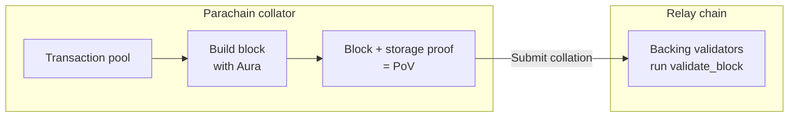
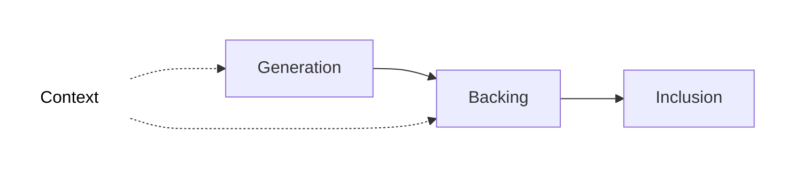

# Parachain Consensus

## Introduction

A parachain built with the Polkadot SDK does not run its own finality protocol. Its collators author blocks, and relay chain validators check and finalize them. On the parachain side, this work is done by [Cumulus](https://paritytech.github.io/polkadot-sdk/master/polkadot_sdk_docs/polkadot_sdk/cumulus/index.html), the set of client libraries and pallets that turns a FRAME runtime and a node into a parachain.

This page describes what the Cumulus collator and the parachain runtime do to get a block from the transaction pool to the relay chain, and how the stages on the relay chain (the inclusion pipeline) relate to that work. For the relay chain side of the protocol (validator assignment, availability, approval checking, disputes, and the economic security behind them), see the [Parachains](https://wiki.polkadot.com/learn/learn-parachains/) page on the Polkadot Wiki.

## Components

The [parachain template](https://github.com/paritytech/polkadot-sdk/tree/{{dependencies.repositories.polkadot_sdk.version}}/templates/parachain) wires the following consensus components together:

- **`pallet_aura`**: Runtime pallet that defines the set of block authors and the slot duration. Collators take turns authoring blocks in Aura slots.
- **`cumulus_pallet_aura_ext`**: Runtime pallet that connects Aura to Cumulus. It provides the `FixedVelocityConsensusHook` and the block executor used during validation.
- **`cumulus_pallet_parachain_system`**: Runtime pallet that receives relay chain data through the `set_validation_data` inherent, enforces the consensus hook, and registers the `validate_block` function that relay chain validators run.
- **Aura collator**: Node-side block authoring logic from [`cumulus_client_consensus_aura::collators`](https://paritytech.github.io/polkadot-sdk/master/cumulus_client_consensus_aura/collators/index.html). The template node uses the `lookahead` collator, and `polkadot-omni-node` can also run the `slot_based` collator.

In the template runtime, the validation entry point is registered with the [`register_validate_block!`](https://paritytech.github.io/polkadot-sdk/master/cumulus_pallet_parachain_system/macro.register_validate_block.html) macro, using the Aura block executor:

```rust
cumulus_pallet_parachain_system::register_validate_block! {
	Runtime = Runtime,
	BlockExecutor = cumulus_pallet_aura_ext::BlockExecutor::<Runtime, Executive>,
}
```

## What the Collator Does

For each block it authors, a Cumulus collator goes through the following steps:

1. **Claim the slot**: The collator checks whether one of its Aura keys is the author for the current slot. Only the slot owner authors a block.
2. **Choose a parent**: The collator picks a relay chain block to build against (the relay parent) and a parachain parent block. With asynchronous backing, the parent can be a block that is not yet included on the relay chain, as long as the runtime's `AuraUnincludedSegmentApi::can_build_upon` allows it.
3. **Build the block**: The collator executes the runtime to build a block. The block includes the `set_validation_data` inherent, which carries the relay parent and a relay chain state proof into the runtime.
4. **Produce the proof of validity**: Alongside the block, the collator records a storage proof of every state item the block reads or writes. The block and this proof form the [proof of validity (PoV)](https://wiki.polkadot.com/general/glossary/#proof-of-validity).
5. **Submit the collation**: The collator compresses the PoV and passes it to the collation generation subsystem, which sends it to the relay chain validators assigned to the parachain's core.

The relay chain validators do not need the parachain's state. They run the parachain's `validate_block` function, which is part of the runtime Wasm blob already registered on the relay chain, against the PoV. If the block's state transitions are valid, the result matches the header the collator produced.



To inspect what a collator submits, `polkadot-omni-node` can write every PoV it builds to a folder with the `--export-pov-to-path` option.

## Inclusion Pipeline

After submission, every parachain block (parablock) passes through the same pipeline on the relay chain. Each stage is carried out by relay chain validators:



- **Context**: To build or check a parablock, collators and validators need the parachain's state context. It comes from two sources: the relay parent, which is the relay chain block the parablock is anchored to, and the unincluded segment, which is the chain of parablocks that collators have built but that the relay chain has not yet included. The relay parent is always a different relay chain block from the one that eventually includes the parablock.
- **Generation**: The collator builds the block and the PoV, as described in [What the Collator Does](#what-the-collator-does).
- **Backing**: The validators assigned to the parachain's core run `validate_block` on the PoV and sign a [validity statement](https://paritytech.github.io/polkadot-sdk/book/types/backing.html#validity-attestation). With enough positive statements, the candidate is backed and its header is placed on the relay chain.
- **Inclusion**: Validators distribute [erasure-coded chunks](https://paritytech.github.io/polkadot-sdk/book/types/availability.html#erasure-chunk) of the PoV so it stays available, and the parablock goes through the [approval process](https://paritytech.github.io/polkadot-sdk/book/protocol-approval.html) before it is considered included.

The relay chain stores only the parablock header, not the full block. The complete block stays on the parachain network.

Whether a parachain uses synchronous or [asynchronous backing](/polkadot-sdk/reference/consensus/async-backing/), all parablocks follow this pipeline. With asynchronous backing, several parablocks can be at different stages at the same time. With [elastic scaling](/polkadot-sdk/reference/consensus/elastic-scaling/), parablocks are also spread across more than one core.

## Where to Go Next

<div class="grid cards" markdown>

-   <span class="badge learn">Learn</span> __Asynchronous Backing__

    ---

    Configure the runtime constants and the lookahead collator that let collators build ahead of the relay chain.

    [:octicons-arrow-right-24: Asynchronous Backing](/polkadot-sdk/reference/consensus/async-backing/)

-   <span class="badge learn">Learn</span> __Elastic Scaling__

    ---

    Configure the slot-based collator and the runtime to produce blocks on more than one core.

    [:octicons-arrow-right-24: Elastic Scaling](/polkadot-sdk/reference/consensus/elastic-scaling/)

-   <span class="badge external">Learn</span> __Parachain Protocol__

    ---

    Read about the relay chain side of parachain validation on the Polkadot Wiki.

    [:octicons-arrow-right-24: Parachains](https://wiki.polkadot.com/learn/learn-parachains/)

</div>
