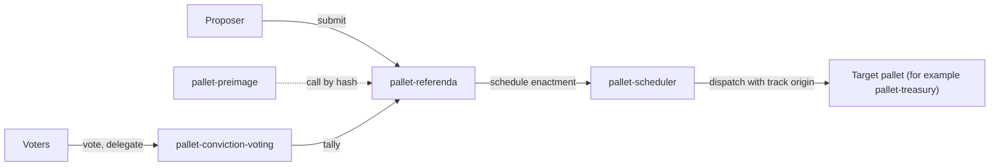
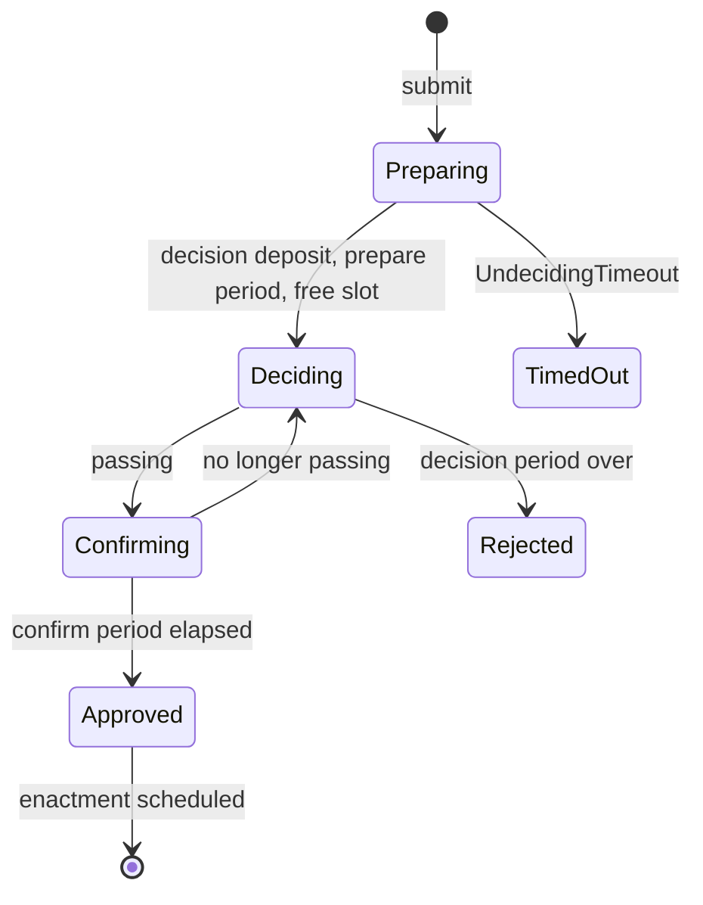

# Governance Pallets

## Introduction

The Polkadot SDK ships a set of FRAME pallets that, combined, give a runtime on-chain governance in the style known as OpenGov: anyone can submit a proposal as a referendum, token holders vote with optional conviction, and an approved proposal is dispatched with a privileged origin. None of these pallets is specific to one network. Any chain built with the Polkadot SDK can add them and choose its own tracks, origins, deposits, and timings.

This page describes what each pallet contributes, how they fit together, and how a runtime wires them up, using the governance module of the Asset Hub Westend runtime in the Polkadot SDK as the worked example. All source links point to the `{{ dependencies.repositories.polkadot_sdk.version }}` release. For how governance works on the Polkadot network itself, including its live tracks and parameters, see [developers.polkadot.com](https://developers.polkadot.com/).

## How the Pallets Fit Together

A minimal OpenGov-style setup combines the following pallets:

- **[`pallet-referenda`](https://paritytech.github.io/polkadot-sdk/master/pallet_referenda/index.html)**: Holds referenda, assigns each one to a track based on its proposal origin, and moves it through its lifecycle. It contains no voting logic.
- **[`pallet-conviction-voting`](https://paritytech.github.io/polkadot-sdk/master/pallet_conviction_voting/index.html)**: Records token-holder votes and delegations, locks the voted balance, and supplies the tally that `pallet-referenda` evaluates.
- **[`pallet-preimage`](https://paritytech.github.io/polkadot-sdk/master/pallet_preimage/index.html)**: Stores the encoded calls that proposals refer to by hash.
- **[`pallet-scheduler`](https://paritytech.github.io/polkadot-sdk/master/pallet_scheduler/index.html)**: Dispatches approved proposals at their enactment block, and wakes referenda up when their state needs to change.
- **A custom origins pallet**: A small pallet defined in the runtime that declares the privileged origins referenda can dispatch with, such as `Treasurer` or `ReferendumCanceller`.

Two further pallets are optional:

- **[`pallet-whitelist`](https://paritytech.github.io/polkadot-sdk/master/pallet_whitelist/index.html)**: Lets an expert body pre-approve specific calls so that a dedicated track can dispatch them as `Root` with lower thresholds.
- **[`pallet-ranked-collective`](https://paritytech.github.io/polkadot-sdk/master/pallet_ranked_collective/index.html)**: Provides a ranked membership body whose members vote by rank, through a second instance of `pallet-referenda`.

Pallets such as [`pallet-treasury`](https://paritytech.github.io/polkadot-sdk/master/pallet_treasury/index.html) then consume the origins that governance produces.



## Referenda

`pallet-referenda` decides whether a proposal should be dispatched from a particular origin. The proposal origin selects the track, and the track supplies every parameter of the decision process. The pallet is instantiable, so a runtime can run several independent referenda systems, for example one for token holders and one for a ranked collective.

### Tracks

A track is a set of parameters for referenda that dispatch with a given origin. A runtime defines its tracks by implementing the [`TracksInfo`](https://paritytech.github.io/polkadot-sdk/master/pallet_referenda/trait.TracksInfo.html) trait and passing the implementation as `Config::Tracks`. The trait has two required items besides its associated types:

- **`tracks()`**: Returns an iterator over every `Track`, sorted by track ID. The default `check_integrity()` function verifies the ordering.
- **`track_for(origin)`**: Maps a proposal origin to a track ID, or returns `Err(())` if no track accepts that origin. A proposal with an origin that has no track cannot be submitted.

Each `Track` pairs an `id` with a `TrackInfo` struct, which has the following fields:

- **`name`**: A short name for the track, stored as a fixed-length byte array.
- **`max_deciding`**: The maximum number of referenda on this track that can be in the deciding phase at once.
- **`decision_deposit`**: The amount that must be placed on deposit before a referendum can start deciding.
- **`prepare_period`**: The minimum time between submission and the start of the deciding phase.
- **`decision_period`**: The time a referendum has to be approved once it starts deciding.
- **`confirm_period`**: The time the approval criteria must hold without interruption before the referendum is approved.
- **`min_enactment_period`**: The minimum time between approval and dispatch of the proposal.
- **`min_approval`**: A `Curve` giving the minimum approval as a function of time into the decision period.
- **`min_support`**: A `Curve` giving the minimum support as a function of time into the decision period.

### Approval and Support

A referendum is passing when both of its measured values are at or above the track's curves for the current point in the decision period:

- **Approval**: Aye votes as a share of all aye and nay votes, both weighted by conviction.
- **Support**: Aye votes before conviction is applied, as a share of the total votes that could be cast. With `pallet-conviction-voting`, the total is the `MaxTurnout` configuration item.

The [`Curve`](https://paritytech.github.io/polkadot-sdk/master/pallet_referenda/enum.Curve.html) type has three variants: `LinearDecreasing`, `SteppedDecreasing`, and `Reciprocal`. Runtimes usually build curves at compile time with the `Curve::make_linear(length, period, floor, ceil)` and `Curve::make_reciprocal(delay, period, level, floor, ceil)` constant functions. Because the thresholds generally fall over time, a referendum with strong early backing can pass sooner, while one with weak backing has to wait until the curve meets it.

### Referendum Lifecycle

A referendum moves through the following stages:

1. **Submission**: An account allowed by `SubmitOrigin` calls `submit` with the proposal origin, the proposal, and the desired enactment moment. The `SubmissionDeposit` is reserved from the submitter. The track is chosen with `track_for`.
2. **Preparation**: The referendum waits until three conditions hold: someone has placed the track's decision deposit with `place_decision_deposit`, the `prepare_period` has elapsed, and the track has fewer than `max_deciding` referenda in the deciding phase. If the track is full, the referendum joins a per-track queue limited by `MaxQueued`. A referendum that has not started deciding within `UndecidingTimeout` of submission concludes as timed out.
3. **Deciding**: The tally is compared with the track's approval and support curves. If the decision period ends without the referendum entering confirmation, it is rejected.
4. **Confirming**: Once the referendum is passing, it enters confirmation. If it stays passing for the whole `confirm_period`, it is approved. If it stops passing, it returns to deciding. Confirmation can run past the end of the decision period.
5. **Enactment**: The approved proposal is scheduled through `Config::Scheduler` for the later of the requested enactment moment and the current block plus `min_enactment_period`, then dispatched with the proposal origin.

Votes can be cast and changed from submission until the referendum concludes. A referendum can also end through `cancel` (by `CancelOrigin`) or `kill` (by `KillOrigin`, which also slashes the deposits). After a referendum concludes, `refund_decision_deposit` returns the decision deposit unless the referendum was killed, and `refund_submission_deposit` returns the submission deposit only if the referendum was approved or cancelled.



### Configuration

The main [`Config`](https://paritytech.github.io/polkadot-sdk/master/pallet_referenda/pallet/trait.Config.html) items are:

- **`Scheduler`**: The scheduler used for enactment and for internal alarms, normally `pallet-scheduler`.
- **`Currency`**: The reservable currency used for deposits.
- **`SubmitOrigin`**: The origin that can submit referenda. Its `Success` value is the submitting account.
- **`CancelOrigin` and `KillOrigin`**: The origins that can cancel or kill an ongoing referendum.
- **`Slash`**: The handler for slashed deposits.
- **`Votes` and `Tally`**: The vote-counting types, supplied by the voting pallet, for example `pallet_conviction_voting::VotesOf<Runtime>` and `pallet_conviction_voting::TallyOf<Runtime>`.
- **`SubmissionDeposit`**: The deposit reserved on submission.
- **`MaxQueued`**: The maximum length of each track's queue.
- **`UndecidingTimeout`**: The time after submission by which a referendum must start deciding.
- **`AlarmInterval`**: The quantization of the internal wake-up alarms. A higher value reduces storage work but delays automatic status changes.
- **`Tracks`**: The `TracksInfo` implementation.
- **`Preimages`**: The preimage provider, normally `pallet-preimage`.
- **`BlockNumberProvider`**: The source of the block number used for all periods.

### Calls

The pallet exposes the following calls:

- **`submit`**: Submits a proposal with its origin and enactment moment.
- **`place_decision_deposit`**: Places the track's decision deposit for a referendum. Any signed account can call it.
- **`refund_decision_deposit` and `refund_submission_deposit`**: Return deposits after a referendum concludes, where allowed.
- **`cancel` and `kill`**: End an ongoing referendum. `kill` also slashes the deposits.
- **`set_metadata`**: Sets or clears the hash of a preimage that holds metadata for a referendum.
- **`nudge_referendum` and `one_fewer_deciding`**: Advance a referendum or a track to its next state. These are `Root`-only and used internally through the scheduler.

## Conviction Voting

`pallet-conviction-voting` implements voting for polls that a polling pallet, normally `pallet-referenda`, provides through `Config::Polls`. Votes lock the voter's balance instead of transferring it, and the lock stays in place for a period that depends on the vote's conviction.

### Conviction and Lock Periods

A standard vote carries a [`Conviction`](https://paritytech.github.io/polkadot-sdk/master/pallet_conviction_voting/enum.Conviction.html), which multiplies the voting balance and sets how long the balance stays locked after the poll ends, if the vote was on the winning side. The lock duration is the conviction's lock periods multiplied by `VoteLockingPeriod`.

| Conviction | Vote multiplier | Lock periods |
| :--------: | :-------------: | :----------: |
|   `None`   |      0.1x       |      0       |
| `Locked1x` |       1x        |      1       |
| `Locked2x` |       2x        |      2       |
| `Locked3x` |       3x        |      4       |
| `Locked4x` |       4x        |      8       |
| `Locked5x` |       5x        |      16      |
| `Locked6x` |       6x        |      32      |

The `AccountVote` type has three forms:

- **`Standard`**: A single aye or nay with a conviction and a balance.
- **`Split`**: Separate aye and nay balances, without conviction.
- **`SplitAbstain`**: Separate aye, nay, and abstain balances, without conviction.

### Classes and Delegation

Votes and locks are tracked per class. With `pallet-referenda`, the class of a poll is its track ID, so an account can vote on referenda in several tracks at once and holds a separate lock per track. The overall balance lock under the `pyconvot` lock identifier is the largest of the per-class locks.

An account can delegate its voting power for one class to another account with `delegate`, choosing a conviction and a balance. The delegated balance is locked while the delegation lasts, and for the conviction's lock period after `undelegate`. To delegate several classes, call `delegate` once per class. An account that already has direct votes in a class must remove them before delegating in that class.

### Configuration

The main [`Config`](https://paritytech.github.io/polkadot-sdk/master/pallet_conviction_voting/pallet/trait.Config.html) items are:

- **`Currency`**: The lockable currency used for voting.
- **`Polls`**: The polling pallet, normally the `pallet-referenda` instance.
- **`MaxTurnout`**: The maximum amount of tokens that can vote, used as the denominator for support. It can be the total issuance, or a smaller value that excludes funds unable to vote.
- **`MaxVotes`**: The maximum number of concurrent votes per account. It also affects the weight of calls such as `delegate`.
- **`VoteLockingPeriod`**: The base lock period. The pallet documentation advises a value no shorter than the enactment period, so that successful voters stay locked into the consequences of their votes.
- **`BlockNumberProvider`**: The source of the block number for locks.
- **`VotingHooks`**: Hooks called when a vote is registered or removed. Use `()` for none.

### Calls

The pallet exposes the following calls:

- **`vote`**: Casts or replaces a vote in a poll.
- **`delegate` and `undelegate`**: Start or end a delegation for one class.
- **`unlock`**: Removes expired locks for a class from an account.
- **`remove_vote`**: Removes the caller's vote from a poll. If the poll ended in the vote's favor and its lock has not expired, the lock is kept.
- **`remove_other_vote`**: Removes another account's vote once it has expired.

## Supporting Pallets

### Preimage

Referenda, the scheduler, and the whitelist store proposals as a [`Bounded`](https://paritytech.github.io/polkadot-sdk/master/frame_support/traits/preimages/enum.Bounded.html) call. A call whose encoding is at most 128 bytes can be stored inline. Larger calls are stored as a hash and length, and the encoded call must be noted in `pallet-preimage` before it can be dispatched. The pallet accepts preimages up to 4 MiB.

Accounts note a preimage with `note_preimage` and remove it with `unnote_preimage`. The `ManagerOrigin` can `request_preimage` and `unrequest_preimage` to keep a preimage stored without a deposit. The `Consideration` configuration item sets the cost of storing a preimage, typically a balance hold that grows with its size.

### Scheduler

`pallet-referenda` uses the scheduler in two ways: it schedules named alarms that advance referenda through their lifecycle, and it schedules the approved proposal for enactment with the proposal origin. Scheduled calls execute in the scheduler's `on_initialize` hook, within `MaximumWeight` and at most `MaxScheduledPerBlock` per block. The scheduler's `PalletsOrigin` must be the runtime's `OriginCaller`, so that it can dispatch with any origin, including custom governance origins.

The scheduler also has its own calls, such as `schedule`, `schedule_named`, and `cancel`, restricted to `ScheduleOrigin`. Set `MaxScheduledPerBlock` high enough for the alarms that referenda create when many polls are active.

### Whitelist

`pallet-whitelist` lets an expert body fast-track specific calls without giving it unilateral power. It involves two origins:

- **`WhitelistOrigin`**: Whitelists a call hash with `whitelist_call`, or removes it with `remove_whitelisted_call`. This is usually the origin of a technical body.
- **`DispatchWhitelistedOrigin`**: Dispatches a whitelisted call with the `Root` origin through `dispatch_whitelisted_call` or `dispatch_whitelisted_call_with_preimage`. This is usually a custom `WhitelistedCaller` origin produced by a dedicated referenda track.

A runtime gives the `WhitelistedCaller` track lower thresholds than the `Root` track, because the expert body has already approved the exact call. If the referendum passes before the call is whitelisted, the dispatch is deferred: any signed account can then complete it once the call is whitelisted, until `DeferredDispatchExpiration` elapses. Expired entries are removed with `remove_deferred_dispatch`.

In the Rococo runtime, for example, `WhitelistOrigin` accepts a `Fellows` origin that a ranked-collective referendum produces; see [`polkadot/runtime/rococo/src/governance/mod.rs`](https://github.com/paritytech/polkadot-sdk/blob/{{dependencies.repositories.polkadot_sdk.version}}/polkadot/runtime/rococo/src/governance/mod.rs).

### Ranked Collective

`pallet-ranked-collective` is a membership pallet in which every member has a rank, starting at zero. It implements a tally for `pallet-referenda`, so a second referenda instance can run polls where only members vote. Two configuration items control rank privileges:

- **`MinRankOfClass`**: The minimum rank allowed to vote on a class of poll. With `sp_runtime::traits::Identity`, track ID `n` admits members of rank `n` and above.
- **`VoteWeight`**: The weight of a vote based on how far the voter's rank exceeds the poll's minimum rank. The pallet provides `Unit` (one vote each), `Linear` (one extra vote per excess rank), and `Geometric` (1, 3, 6, 10, and so on).

Members vote with `vote(poll, aye)`. Membership changes through `add_member`, `promote_member`, `demote_member`, `remove_member`, and `exchange_member`, each guarded by its own origin (`AddOrigin`, `PromoteOrigin`, `DemoteOrigin`, `RemoveOrigin`, and `ExchangeOrigin`). Ranks change by one at a time. The pallet also provides origin guards, `EnsureRanked`, `EnsureMember`, and `EnsureRankedMember`, that check whether a signed account is a member of at least a given rank.

The Rococo fellowship shows the pattern: [`polkadot/runtime/rococo/src/governance/fellowship.rs`](https://github.com/paritytech/polkadot-sdk/blob/{{dependencies.repositories.polkadot_sdk.version}}/polkadot/runtime/rococo/src/governance/fellowship.rs) configures `pallet_referenda::Instance2` with `Votes = pallet_ranked_collective::Votes` and `Tally = pallet_ranked_collective::TallyOf<Runtime, FellowshipCollectiveInstance>`, and sets the collective's `Polls` to that referenda instance. For running more than one instance of a pallet, see [Add Multiple Pallet Instances](/polkadot-sdk/customize-runtime/add-pallet-instances.md).

### Treasury

`pallet-treasury` is a common consumer of governance origins. Its `SpendOrigin` is an `EnsureOrigin` whose `Success` value is the maximum amount the origin may spend at once. A runtime typically maps a set of spender origins, each with its own track and limit, to `SpendOrigin`, and a `Treasurer` origin to `RejectOrigin`. An approved referendum calls `spend` to create a spend for an asset kind, amount, and beneficiary, and the spend is then claimed with `payout` within `PayoutPeriod`.

## Custom Origins

Tracks are selected by origin, so a runtime needs one origin per track. `Root` comes from `frame_system`. The others come from a small pallet in the runtime that declares an origin enum with `#[pallet::origin]` and an `EnsureOrigin` type for each variant. Other pallets then use those types in their configuration, for example `CancelOrigin = EitherOf<EnsureRoot<AccountId>, ReferendumCanceller>`.

In Asset Hub Westend, the governance module is split into three files:

- **[`governance/origins.rs`](https://github.com/paritytech/polkadot-sdk/blob/{{dependencies.repositories.polkadot_sdk.version}}/cumulus/parachains/runtimes/assets/asset-hub-westend/src/governance/origins.rs)**: Declares `pallet_custom_origins` with an `Origin` enum (`StakingAdmin`, `Treasurer`, `WhitelistedCaller`, `ReferendumCanceller`, and more). It generates an `EnsureOrigin` type per variant with the `decl_unit_ensures!` macro, and a `Spender` type whose `Success` value is a spend limit with the `decl_ensure!` macro.
- **[`governance/tracks.rs`](https://github.com/paritytech/polkadot-sdk/blob/{{dependencies.repositories.polkadot_sdk.version}}/cumulus/parachains/runtimes/assets/asset-hub-westend/src/governance/tracks.rs)**: Defines the curves and the `TRACKS_DATA` array, and implements `TracksInfo`. `track_for` maps `frame_system::RawOrigin::Root` to track `0` and each custom origin to its own track ID.
- **[`governance/mod.rs`](https://github.com/paritytech/polkadot-sdk/blob/{{dependencies.repositories.polkadot_sdk.version}}/cumulus/parachains/runtimes/assets/asset-hub-westend/src/governance/mod.rs)**: Implements `Config` for `pallet-conviction-voting`, `pallet-referenda`, the custom origins pallet, `pallet-whitelist`, `pallet-treasury`, and related pallets.

!!! note
    Asset Hub Westend is a test network runtime, and its track periods and deposits are tuned for testing. Choose curves, periods, and deposits for your own chain instead of copying them.

## Add Governance to Your Runtime

The following outline shows the order of steps and the main configuration, trimmed from the Asset Hub Westend runtime. Values marked as placeholders are not recommendations. For the general process of adding a pallet, including `Cargo.toml` features and the `std` feature list, see [Add an Existing Pallet to the Runtime](/polkadot-sdk/customize-runtime/add-existing-pallets.md).

1. Add the pallets as features of the `polkadot-sdk` dependency in `runtime/Cargo.toml`:

    ```toml title="runtime/Cargo.toml"
    polkadot-sdk = { workspace = true, features = [
        "pallet-conviction-voting",
        "pallet-preimage",
        "pallet-referenda",
        "pallet-scheduler",
        "pallet-whitelist",
        # ... other features
    ], default-features = false }
    ```

2. Configure `pallet-preimage` and `pallet-scheduler`. Both are needed before referenda can store and enact proposals:

    ```rust title="runtime/src/configs/mod.rs"
    use frame_support::traits::{fungible::HoldConsideration, LinearStoragePrice};
    use super::{OriginCaller, Preimage};

    parameter_types! {
        pub MaximumSchedulerWeight: Weight =
            Perbill::from_percent(80) * RuntimeBlockWeights::get().max_block;
        pub const PreimageBaseDeposit: Balance = deposit(2, 64);
        pub const PreimageByteDeposit: Balance = deposit(0, 1);
        pub const PreimageHoldReason: RuntimeHoldReason =
            RuntimeHoldReason::Preimage(pallet_preimage::HoldReason::Preimage);
    }

    impl pallet_scheduler::Config for Runtime {
        type RuntimeOrigin = RuntimeOrigin;
        type RuntimeEvent = RuntimeEvent;
        type PalletsOrigin = OriginCaller;
        type RuntimeCall = RuntimeCall;
        type MaximumWeight = MaximumSchedulerWeight;
        type ScheduleOrigin = EnsureRoot<AccountId>;
        type MaxScheduledPerBlock = ConstU32<50>;
        type WeightInfo = pallet_scheduler::weights::SubstrateWeight<Runtime>;
        type OriginPrivilegeCmp = frame_support::traits::EqualPrivilegeOnly;
        type Preimages = Preimage;
        type BlockNumberProvider = System;
    }

    impl pallet_preimage::Config for Runtime {
        type WeightInfo = pallet_preimage::weights::SubstrateWeight<Runtime>;
        type RuntimeEvent = RuntimeEvent;
        type Currency = Balances;
        type ManagerOrigin = EnsureRoot<AccountId>;
        type Consideration = HoldConsideration<
            AccountId,
            Balances,
            PreimageHoldReason,
            LinearStoragePrice<PreimageBaseDeposit, PreimageByteDeposit, Balance>,
        >;
    }
    ```

    Asset Hub Westend sets the scheduler's `BlockNumberProvider` to `RelaychainDataProvider<Runtime>`. The `pallet-scheduler` documentation recommends the local `frame_system` block number for solo chains, relay chains, and parachains for now, which is what this outline uses. The `deposit` function comes from the example runtime's `testnet-parachains-constants` dependency, and the parachain template has no equivalent, so define one for your chain, for example `pub const fn deposit(items: u32, bytes: u32) -> Balance`. `OriginCaller` and `Preimage` are generated by the runtime construct in step 6.

3. Declare the custom origins pallet. The example trims the Asset Hub Westend enum to four variants and generates an `EnsureOrigin` implementation for each one with a macro, as the Asset Hub Westend runtime does. The parachain template imports FRAME through the `polkadot-sdk` umbrella crate, so the pallet imports `frame_support` from it and names the full `polkadot_sdk::frame_system::Config` supertrait:

    ```rust title="runtime/src/governance/origins.rs"
    pub use pallet_custom_origins::*;

    use polkadot_sdk::frame_support;

    #[frame_support::pallet]
    pub mod pallet_custom_origins {
        use polkadot_sdk::frame_support::pallet_prelude::*;

        #[pallet::config]
        pub trait Config: polkadot_sdk::frame_system::Config {}

        #[pallet::pallet]
        pub struct Pallet<T>(_);

        #[derive(
            PartialEq, Eq, Clone, MaxEncodedLen, Encode, Decode, DecodeWithMemTracking, TypeInfo, Debug,
        )]
        #[pallet::origin]
        pub enum Origin {
            /// Origin able to cancel referenda.
            ReferendumCanceller,
            /// Origin able to kill referenda.
            ReferendumKiller,
            /// Origin for administering the treasury.
            Treasurer,
            /// Origin able to dispatch a whitelisted call.
            WhitelistedCaller,
        }

        // Generates an `EnsureOrigin` implementation for each origin variant,
        // as the Asset Hub Westend runtime does.
        macro_rules! decl_unit_ensures {
            ( $( $name:ident ),* $(,)? ) => { $(
                pub struct $name;
                impl<O: Into<Result<Origin, O>> + From<Origin>> EnsureOrigin<O> for $name {
                    type Success = ();
                    fn try_origin(o: O) -> Result<Self::Success, O> {
                        o.into().and_then(|o| match o {
                            Origin::$name => Ok(()),
                            r => Err(O::from(r)),
                        })
                    }
                    #[cfg(feature = "runtime-benchmarks")]
                    fn try_successful_origin() -> Result<O, ()> {
                        Ok(O::from(Origin::$name))
                    }
                }
            )* };
        }
        decl_unit_ensures!(ReferendumCanceller, ReferendumKiller, Treasurer, WhitelistedCaller);
    }
    ```

4. Define the tracks and implement `TracksInfo`. Every origin that `track_for` returns needs a track in `TRACKS_DATA`, and the array must be sorted by ID:

    ```rust title="runtime/src/governance/tracks.rs"
    use super::*;
    use alloc::borrow::Cow;
    use pallet_referenda::Curve;
    use sp_runtime::str_array as s;

    const fn percent(x: i32) -> sp_arithmetic::FixedI64 {
        sp_arithmetic::FixedI64::from_rational(x as u128, 100)
    }

    // Placeholder curves: choose values for your chain.
    const APP_ROOT: Curve = Curve::make_reciprocal(4, 28, percent(80), percent(50), percent(100));
    const SUP_ROOT: Curve = Curve::make_linear(28, 28, percent(0), percent(50));
    const APP_WHITELISTED_CALLER: Curve =
        Curve::make_reciprocal(16, 28 * 24, percent(96), percent(50), percent(100));
    const SUP_WHITELISTED_CALLER: Curve =
        Curve::make_reciprocal(1, 28, percent(20), percent(5), percent(50));

    const TRACKS_DATA: [pallet_referenda::Track<u16, Balance, BlockNumber>; 2] = [
        pallet_referenda::Track {
            id: 0,
            info: pallet_referenda::TrackInfo {
                name: s("root"),
                max_deciding: 1,
                decision_deposit: 100 * UNIT,   // Placeholder
                prepare_period: 2 * HOURS,      // Placeholder
                decision_period: 14 * DAYS,     // Placeholder
                confirm_period: 1 * DAYS,       // Placeholder
                min_enactment_period: 1 * DAYS, // Placeholder
                min_approval: APP_ROOT,
                min_support: SUP_ROOT,
            },
        },
        pallet_referenda::Track {
            id: 1,
            info: pallet_referenda::TrackInfo {
                name: s("whitelisted_caller"),
                max_deciding: 100,
                decision_deposit: 10 * UNIT,       // Placeholder
                prepare_period: 30 * MINUTES,      // Placeholder
                decision_period: 14 * DAYS,        // Placeholder
                confirm_period: 10 * MINUTES,      // Placeholder
                min_enactment_period: 10 * MINUTES, // Placeholder
                min_approval: APP_WHITELISTED_CALLER,
                min_support: SUP_WHITELISTED_CALLER,
            },
        },
    ];

    pub struct TracksInfo;
    impl pallet_referenda::TracksInfo<Balance, BlockNumber> for TracksInfo {
        type Id = u16;
        type RuntimeOrigin = <RuntimeOrigin as frame_support::traits::OriginTrait>::PalletsOrigin;

        fn tracks(
        ) -> impl Iterator<Item = Cow<'static, pallet_referenda::Track<Self::Id, Balance, BlockNumber>>>
        {
            TRACKS_DATA.iter().map(Cow::Borrowed)
        }

        fn track_for(id: &Self::RuntimeOrigin) -> Result<Self::Id, ()> {
            if let Ok(system_origin) = frame_system::RawOrigin::try_from(id.clone()) {
                match system_origin {
                    frame_system::RawOrigin::Root => Ok(0),
                    _ => Err(()),
                }
            } else if let Ok(custom_origin) = origins::Origin::try_from(id.clone()) {
                match custom_origin {
                    origins::Origin::WhitelistedCaller => Ok(1),
                    // Add a track for each remaining custom origin.
                    _ => Err(()),
                }
            } else {
                Err(())
            }
        }
    }
    ```

5. Configure `pallet-conviction-voting`, `pallet-referenda`, the custom origins pallet, and `pallet-whitelist`:

    ```rust title="runtime/src/governance/mod.rs"
    use super::*;
    use frame_support::{
        parameter_types,
        traits::{ConstU32, EitherOf},
    };
    use frame_system::EnsureRoot;

    mod origins;
    pub use origins::{
        pallet_custom_origins, ReferendumCanceller, ReferendumKiller, Treasurer, WhitelistedCaller,
    };
    mod tracks;
    pub use tracks::TracksInfo;

    parameter_types! {
        pub const VoteLockingPeriod: BlockNumber = 7 * DAYS;   // Placeholder
        pub const AlarmInterval: BlockNumber = 1;
        pub const SubmissionDeposit: Balance = 1 * UNIT;       // Placeholder
        pub const UndecidingTimeout: BlockNumber = 14 * DAYS;  // Placeholder
    }

    impl pallet_conviction_voting::Config for Runtime {
        type WeightInfo = pallet_conviction_voting::weights::SubstrateWeight<Self>;
        type RuntimeEvent = RuntimeEvent;
        type Currency = Balances;
        type VoteLockingPeriod = VoteLockingPeriod;
        type MaxVotes = ConstU32<512>;
        type MaxTurnout =
            frame_support::traits::tokens::currency::ActiveIssuanceOf<Balances, Self::AccountId>;
        type Polls = Referenda;
        type BlockNumberProvider = System;
        type VotingHooks = ();
    }

    impl origins::pallet_custom_origins::Config for Runtime {}

    impl pallet_referenda::Config for Runtime {
        type WeightInfo = pallet_referenda::weights::SubstrateWeight<Self>;
        type RuntimeCall = RuntimeCall;
        type RuntimeEvent = RuntimeEvent;
        type Scheduler = Scheduler;
        type Currency = Balances;
        type SubmitOrigin = frame_system::EnsureSigned<AccountId>;
        type CancelOrigin = EitherOf<EnsureRoot<AccountId>, ReferendumCanceller>;
        type KillOrigin = EitherOf<EnsureRoot<AccountId>, ReferendumKiller>;
        type Slash = (); // Burns slashed deposits; a runtime can route them to a treasury instead.
        type Votes = pallet_conviction_voting::VotesOf<Runtime>;
        type Tally = pallet_conviction_voting::TallyOf<Runtime>;
        type SubmissionDeposit = SubmissionDeposit;
        type MaxQueued = ConstU32<100>;
        type UndecidingTimeout = UndecidingTimeout;
        type AlarmInterval = AlarmInterval;
        type Tracks = TracksInfo;
        type Preimages = Preimage;
        type BlockNumberProvider = System;
    }

    impl pallet_whitelist::Config for Runtime {
        type WeightInfo = pallet_whitelist::weights::SubstrateWeight<Self>;
        type RuntimeCall = RuntimeCall;
        type RuntimeEvent = RuntimeEvent;
        // Replace with the origin of your expert body. Asset Hub Westend accepts
        // `Root` or a Fellowship origin that arrives over XCM.
        type WhitelistOrigin = EnsureRoot<Self::AccountId>;
        type DispatchWhitelistedOrigin = EitherOf<EnsureRoot<Self::AccountId>, WhitelistedCaller>;
        type DeferredDispatchExpiration = ConstU32<{ 28 * DAYS }>; // Placeholder
        type BlockNumberProvider = System;
        type Preimages = Preimage;
    }
    ```

6. Add the module and register the pallets in the runtime construct. In `runtime/src/lib.rs`, declare `mod governance;` and import the custom origins pallet, then pick free pallet indices:

    ```rust title="runtime/src/lib.rs"
    mod governance;
    use governance::pallet_custom_origins;

    #[frame_support::runtime]
    mod runtime {
        // ... existing pallets

        #[runtime::pallet_index(40)]
        pub type Preimage = pallet_preimage;
        #[runtime::pallet_index(41)]
        pub type Scheduler = pallet_scheduler;
        #[runtime::pallet_index(42)]
        pub type ConvictionVoting = pallet_conviction_voting;
        #[runtime::pallet_index(43)]
        pub type Referenda = pallet_referenda;
        #[runtime::pallet_index(44)]
        pub type Origins = pallet_custom_origins;
        #[runtime::pallet_index(45)]
        pub type Whitelist = pallet_whitelist;
    }
    ```

7. Point privileged configuration items at the new origins. For example, set `pallet-treasury`'s `RejectOrigin` to `EitherOfDiverse<EnsureRoot<AccountId>, Treasurer>`, as Asset Hub Westend does. Once governance can dispatch `Root` calls, plan how to remove `pallet-sudo` with a [runtime upgrade](/polkadot-sdk/runtime-maintenance/runtime-upgrades.md).

This outline compiles when applied to the parachain template at `{{dependencies.repositories.polkadot_sdk.version}}`, with and without the `runtime-benchmarks` feature, and passes the runtime's integrity tests. It uses Substrate's default weights; generate weights for your runtime and add benchmarking helpers before you deploy, using the linked Asset Hub Westend files as the reference.

## Where to Go Next

<div class="grid cards" markdown>

-   <span class="badge guide">Guide</span> __Add an Existing Pallet__

    ---

    Walk through adding and configuring a Polkadot SDK pallet in a parachain runtime.

    [:octicons-arrow-right-24: Get Started](/polkadot-sdk/customize-runtime/add-existing-pallets.md)

-   <span class="badge guide">Guide</span> __Add Multiple Pallet Instances__

    ---

    Run more than one instance of a pallet, as a ranked-collective referenda system does.

    [:octicons-arrow-right-24: Get Started](/polkadot-sdk/customize-runtime/add-pallet-instances.md)

-   <span class="badge guide">Guide</span> __Runtime Upgrades__

    ---

    Upgrade your runtime through governance instead of a privileged key.

    [:octicons-arrow-right-24: Learn More](/polkadot-sdk/runtime-maintenance/runtime-upgrades.md)

</div>
