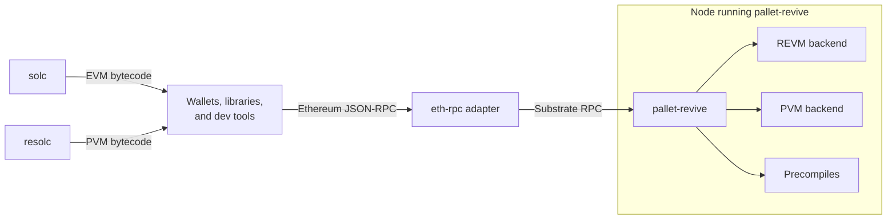

# Smart Contracts Overview

## Introduction

[`pallet-revive`](https://paritytech.github.io/polkadot-sdk/master/pallet_revive/index.html) is the Polkadot SDK pallet that adds Ethereum-compatible smart contracts to a runtime. A chain running pallet-revive accepts signed Ethereum transactions, executes Solidity contracts, and serves the standard Ethereum JSON-RPC interface through an adapter, so Ethereum wallets, libraries, and development tools can connect to it without modification. Polkadot Hub is one example of a chain running pallet-revive. You can also run it on a [local development node](/smart-contracts/dev-environments/local-dev-node/) or [add it to your own runtime](/polkadot-sdk/customize-runtime/add-pallet-revive/).

The smart contract stack consists of the following components:

- **pallet-revive**: The runtime module that stores and executes contracts, maps accounts, and meters resources.
- **Execution backends**: REVM for EVM bytecode and PVM for contracts compiled to PolkaVM.
- **`resolc`**: The compiler that turns Solidity into PVM bytecode.
- **`eth-rpc`**: The Ethereum JSON-RPC adapter that sits between Ethereum tooling and the node.
- **Precompiles**: Built-in contracts that pallet-revive implements natively in the runtime.

## pallet-revive

pallet-revive is the runtime module that executes smart contracts. It decodes Ethereum transactions submitted through the [`eth_transact`](https://paritytech.github.io/polkadot-sdk/master/pallet_revive/pallet/dispatchables/fn.eth_transact.html) dispatchable, runs the contract code on the appropriate backend, and returns Ethereum-compatible results. Because pallet-revive lives in the runtime rather than in the node binary, a chain gains Ethereum compatibility without changes to its node client.

pallet-revive also handles the parts of the execution model that differ from Ethereum:

- **Accounts**: It maps 20-byte Ethereum addresses to 32-byte Polkadot SDK account IDs. See [Accounts](/smart-contracts/for-eth-devs/accounts/).
- **Gas and fees**: It meters three resources (`ref_time`, `proof_size`, and `storage_deposit`) and maps them to a single Ethereum gas value. See [Gas Model](/smart-contracts/for-eth-devs/gas-model/).
- **Deployment**: It supports single-step deployment on REVM and a two-step upload and instantiate model on PVM. See [Contract Deployment](/smart-contracts/for-eth-devs/contract-deployment/).

Contracts on one backend can call contracts on the other, so a project can keep most of its logic on REVM and move computationally heavy parts to PVM.

## Execution Backends

pallet-revive runs contracts on two backends. REVM executes standard EVM bytecode and is the default choice for existing Solidity projects. PVM runs contracts compiled to PolkaVM with `resolc`; it is newer, and its tooling is still maturing.

Both backends share the same Ethereum JSON-RPC interface, account model, and precompiles.

### REVM

[REVM](https://github.com/bluealloy/revm) is a Rust implementation of the Ethereum Virtual Machine. On the REVM backend, pallet-revive runs the bytecode produced by the standard Solidity compiler (`solc`) unchanged:

- Existing Ethereum contracts deploy without modification.
- EVM behavior matches Ethereum, so audit tools and bytecode inspection work as expected.
- Deployment is a single transaction, and factory contracts can create new contracts at runtime.

### PVM

[PolkaVM (PVM)](https://github.com/paritytech/polkavm) is a virtual machine based on the RISC-V instruction set. Solidity contracts run on PVM after you compile them with `resolc`. PVM can offer performance gains for computationally intensive workloads, but some low-level EVM behavior differs, particularly around inline assembly, code introspection, and contract creation. See [EVM vs PVM](/smart-contracts/for-eth-devs/evm-vs-pvm/) for the full list of differences.

You can also write PVM contracts in Rust, though tooling for that path is limited.

## The resolc Compiler

[`resolc`](https://github.com/paritytech/revive), the Revive compiler, compiles Solidity to PVM bytecode. It takes the YUL intermediate representation that `solc` produces and translates it for PolkaVM, so contracts compiled with `resolc` behave as if compiled with Solidity's `via-ir` pipeline. `resolc` is available as the [`{{ dependencies.javascript_packages.resolc.name }}`](https://www.npmjs.com/package/@parity/resolc) npm package, and the [Hardhat Polkadot](/smart-contracts/dev-environments/hardhat-polkadot/) plugin uses it to compile contracts for PVM.

Contracts that target REVM do not need `resolc`; they use standard `solc` output. For installation, usage, and options, see [The resolc Compiler](/smart-contracts/resolc/).

## Ethereum JSON-RPC Adapter

The Ethereum JSON-RPC adapter (`eth-rpc`) is a standalone server that ships with pallet-revive. It accepts Ethereum JSON-RPC requests, repackages signed Ethereum transactions as Polkadot SDK transactions, forwards them to the node, and converts the results back into Ethereum-compatible responses. Because the original Ethereum transaction payload is preserved, existing tools can keep processing familiar transaction formats.

- To install, configure, and run the adapter, see [Run the Ethereum JSON-RPC Adapter](/smart-contracts/eth-rpc-adapter/).
- For the supported methods and request examples, see [JSON-RPC APIs](/smart-contracts/for-eth-devs/json-rpc-apis/).
- To run the adapter next to a local node, see [Local Development Node](/smart-contracts/dev-environments/local-dev-node/).
- To run the adapter alongside a production RPC node, see [Ethereum RPC Compatibility](/nodes/run-a-node/parachain-rpc/#ethereum-rpc-compatibility).

## Precompiles

pallet-revive implements a set of precompiles: contracts at fixed addresses whose logic runs natively in the runtime rather than as contract bytecode. They include the standard Ethereum precompiles (such as `ecrecover` and `sha256`) and precompiles that expose runtime functionality, such as ERC-20 access to native assets and cross-chain messaging through [XCM](/smart-contracts/precompiles/xcm/). See [Precompiles](/smart-contracts/precompiles/) for the full list.

## Development Tools

Parity maintains two tools for developing against pallet-revive:

- **[Local development node](/smart-contracts/dev-environments/local-dev-node/)**: The Revive dev node and the `eth-rpc` adapter, built from the Polkadot SDK, give you a local chain at `{{ networks.local.eth_rpc_url }}`.
- **[Hardhat Polkadot](/smart-contracts/dev-environments/hardhat-polkadot/)**: The `{{ dependencies.javascript_packages.hardhat_polkadot.name }}` plugin compiles, tests, and deploys contracts with Hardhat.

Guides for third-party Ethereum tools such as Remix, Foundry, ethers, and viem, as well as other smart contract environments in the Polkadot ecosystem, are on the [Polkadot Developer Docs](https://developers.polkadot.com/smart-contracts/overview/).

## Next Steps

-   Guide __Get Started__

    ---

    Set up a local development environment and deploy your first contract.

    [:octicons-arrow-right-24: Get Started](/smart-contracts/get-started/)

-   Guide __Ethereum Developers__

    ---

    Understand how accounts, gas, and deployment on pallet-revive differ from Ethereum.

    [:octicons-arrow-right-24: Learn More](/smart-contracts/for-eth-devs/accounts/)

-   Guide __Cookbook__

    ---

    Follow step-by-step tutorials for deploying contracts, tokens, NFTs, and full dApps.

    [:octicons-arrow-right-24: View Tutorials](/smart-contracts/cookbook/)

-   Guide __Precompiles__

    ---

    Call native runtime functionality, including XCM, from your contracts.

    [:octicons-arrow-right-24: Explore Precompiles](/smart-contracts/precompiles/)

