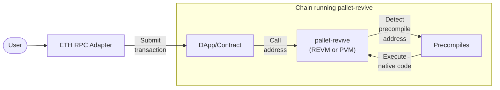

# Advanced Functionalities via Precompiles

## Introduction

Precompiles serve two purposes on chains running `pallet-revive`. They provide native, optimized implementations of frequently used functions, such as hashing and signature recovery, and they give smart contracts access to runtime capabilities that contracts can't implement themselves, such as Cross-Consensus Messaging (XCM), native assets, and low-level storage.

This page explains how precompiles work in `pallet-revive` and lists the precompiles documented in this section.

## What Are Precompiles?

Precompiles are special contract implementations that run directly at the runtime level rather than as deployed contract bytecode. In typical EVM environments, precompiles provide essential cryptographic and utility functionality at fixed addresses. `pallet-revive` follows the same design pattern.

A user sends a transaction to a dApp or contract, usually through the Ethereum JSON-RPC adapter (`eth-rpc`). When the contract calls an address, `pallet-revive` checks whether the address belongs to a precompile. If it does, `pallet-revive` runs the precompile's native code and returns the result to the calling contract, which then returns the result to the user.

## Precompile Addresses

The following table lists the addresses documented on the individual precompile pages:

|                Precompile                 |                       Address                        |                                    Description                                     |
|:-----------------------------------------:|:----------------------------------------------------:|:----------------------------------------------------------------------------------:|
| [Ethereum native](/smart-contracts/precompiles/eth-native.md) |       `0x01` to `0x09` (last byte)        | Standard Ethereum precompiles such as ECRecover, SHA-256, and the alt_bn128 curve operations |
|  [System](/smart-contracts/precompiles/system.md)   |    `0x0000000000000000000000000000000000000900`     |                   Runtime-level utilities such as BLAKE2 hashing, signature verification, and account ID conversion                   |
| [Storage](/smart-contracts/precompiles/storage.md)  |    `0x0000000000000000000000000000000000000901`     |                       Low-level access to contract storage                        |
|     [XCM](/smart-contracts/precompiles/xcm.md)      |    `0x00000000000000000000000000000000000a0000`     |                 Execute, send, and weigh XCM messages                  |
|   [ERC-20](/smart-contracts/precompiles/erc20.md)   | Derived per asset from the asset ID and an instance suffix | ERC-20 interface for assets managed by the Assets pallet |

## Runtime-Registered Precompiles

Not every precompile is part of `pallet-revive` itself. A runtime can register additional precompiles implemented in other pallets, which is how the XCM precompile (from `pallet-xcm`) and the ERC-20 precompile (from the Assets pallet) are provided. Which of these precompiles are available, and at which addresses, depends on the runtime configuration of each chain.

## Conclusion

Precompiles give smart contract developers access to both high-performance operations and core runtime capabilities from within the contract execution context. Through `pallet-revive`, contracts can call these native functions at fixed addresses with the same patterns used for any other contract call.
