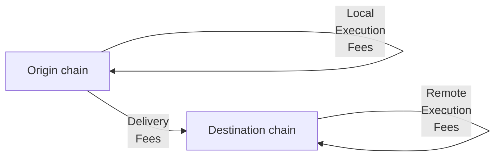

# XCM Fee Estimation

## Introduction

When sending cross-chain messages, ensure that the transaction will succeed not only on the local chain but also on the destination chain and any intermediate chains. Doing so requires estimating the fees for each part of the operation before you submit it.

Polkadot SDK runtimes expose two runtime APIs for this purpose: [`XcmPaymentApi`](https://paritytech.github.io/polkadot-sdk/master/xcm_runtime_apis/fees/trait.XcmPaymentApi.html) for weights and fees, and [`DryRunApi`](https://paritytech.github.io/polkadot-sdk/master/xcm_runtime_apis/dry_run/trait.DryRunApi.html) for simulating a call or message and capturing the messages it would forward. This page explains the fee mechanism and the sequence of runtime API calls that produces a complete estimate. The chains involved are configuration: the same steps work between any two chains whose runtimes expose these APIs, including a local pair of chains started with [Zombienet](/tools/zombienet.md).

## Fee Mechanism

There are three types of fees that can be charged when sending a cross-chain message:

- **Local execution fees**: Fees charged on the origin chain for executing the message.
- **Delivery fees**: Fees charged for delivering the message to the destination chain.
- **Remote execution fees**: Fees charged on the destination chain for executing the message.

If there are multiple intermediate chains, delivery fees and remote execution fees are charged for each one.

For a message sent from an origin chain to a destination chain, the fee structure is as follows:

The overall fees are `local_execution_fees` + `delivery_fees` + `remote_execution_fees`.

## Runtime APIs for Fee Estimation

The following runtime API methods provide the data you need. To expose them from your own runtime, see [Add the XCM Runtime APIs](/polkadot-sdk/interoperability/configure-xcm.md#add-the-xcm-runtime-apis):

| API | Method | Purpose |
|-----|--------|---------|
| `XcmPaymentApi` | `query_xcm_weight` | Returns the weight required to execute an XCM message on the chain you call |
| `XcmPaymentApi` | `query_weight_to_asset_fee` | Converts a weight into a fee in a given asset |
| `XcmPaymentApi` | `query_delivery_fees` | Returns the fees for delivering a message to a given destination |
| `XcmPaymentApi` | `query_acceptable_payment_assets` | Lists the assets the chain accepts for XCM fee payment |
| `DryRunApi` | `dry_run_call` | Simulates a runtime call and returns its effects, including forwarded XCM messages |
| `DryRunApi` | `dry_run_xcm` | Simulates the execution of an XCM message and returns its effects, including forwarded XCM messages |

## Estimate the Fees

To estimate the total fees for a message, call the runtime APIs in the following order:

1. **Local execution fees on the origin chain**: Call `query_xcm_weight` on the origin chain with your XCM message. Then convert the returned weight into a fee with `query_weight_to_asset_fee`, passing the fee asset's location as the origin chain sees it.

2. **Delivery fees to the destination chain**: Call `dry_run_xcm` (or `dry_run_call` for the extrinsic that sends the message) on the origin chain. Find the forwarded message whose destination is the target chain in the result, and pass that destination and message to `query_delivery_fees`.

3. **Remote execution fees on the destination chain**: Connect to the destination chain and call `query_xcm_weight` with the forwarded message from the previous step. Convert the weight into a fee with `query_weight_to_asset_fee`, passing the fee asset's location as the destination chain sees it.

4. **Sum the totals**: Add the three amounts to get the overall fee.

Asset locations are relative to the chain that interprets them. For example, the relay chain's native token is `{ parents: 1, interior: Here }` from a parachain's point of view, but `{ parents: 0, interior: Here }` from the relay chain itself. Use the location that matches the chain you are calling in each step.

## Call the APIs from a Client

With [Subxt](/tools/subxt.md), call these runtime APIs through the runtime API interface generated from each chain's metadata, or through dynamic runtime API calls. Create one client per chain, because steps 1 and 2 run against the origin chain and step 3 runs against the destination chain. For the general pattern, see [Runtime API Calls](/tools/chain-interactions/query-data/runtime-api-calls.md) and the [Subxt runtime API documentation](https://docs.rs/subxt/{{ dependencies.crates.subxt.version }}/subxt/runtime_apis/index.html).

Third-party libraries can call the same APIs, for example [Polkadot API (PAPI)](https://developers.polkadot.com/reference/tools/papi/). For a complete PAPI walkthrough of a teleport between two live system chains, see [XCM Fee Estimation](https://developers.polkadot.com/chain-interactions/send-transactions/interoperability/estimate-xcm-fees/) on developers.polkadot.com.

## Conclusion

Estimating XCM fees accurately means simulating the message on every chain it touches and using the runtime's own fee APIs, rather than hardcoding amounts. The key detail is that asset references change with the perspective of each chain, which matters both for fee estimation and for constructing the XCM message itself.
