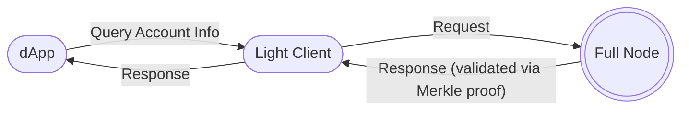

# Light Clients

## Introduction

A light client connects to a blockchain's peer-to-peer network and verifies what full nodes send it, instead of trusting a single JSON-RPC server. It syncs without downloading the chain's full state, so it can run inside a browser tab, a browser extension, a mobile app, or a Node.js process.

Parity maintains two light client projects for Polkadot SDK-based chains:

- [smoldot](https://github.com/paritytech/smoldot): The light client implementation, available as a JavaScript package and as Rust crates.
- [Substrate Connect](https://github.com/paritytech/substrate-connect): npm packages that run smoldot in a web application, or use a light client provided by a browser extension.

This page explains how light clients work, then shows how to connect with smoldot from JavaScript, with Substrate Connect, and from Rust, and how to point a light client at a local network.

!!!note "Light node or light client?"
    The terms _light node_ and _light client_ are interchangeable. Both refer to a client that syncs without downloading the entire blockchain state.

## How Light Clients Work

A light client asks full nodes for data and checks each answer against cryptographic proofs. It does not depend on any one node: it connects to several peers, and a dishonest peer cannot make it accept forged state.



In the diagram, the decentralized application (dApp) queries account information through a light client that runs inside the application. The light client requests the data from a full node and verifies the response with a Merkle proof against the state root of a block header it has already verified.

To verify headers without downloading every block, smoldot uses warp sync: it downloads GRANDPA finality proofs to jump to a recent finalized block, then follows new blocks from there. Light clients verify that blocks are authentic, meaning they were authored and finalized by legitimate validators. They do not execute every block, so applications should read state from finalized blocks.

!!!note "What does it mean to be trust-minimized?"
    _Trust-minimized_ means that the light client does not need to trust the full node it retrieves state from. Merkle proofs let the light client check that the returned data matches the state root in a verified block header.

## Light Clients Compared with Full Nodes

A user interface typically reaches a chain through JSON-RPC in one of two ways:

- **User-controlled node**: The application connects to a node the user runs. This is secure, but installing and maintaining a node is inconvenient.
- **Publicly accessible node**: The application connects to a node someone else runs. This is convenient, but the application trusts that node's answers and needs fallback nodes in case it becomes unavailable.

A light client embedded in the application avoids both trade-offs:

| Full Node                                                        | Light Client                                       |
| :--------------------------------------------------------------: | :------------------------------------------------: |
| Fully verifies all blocks of the chain                           | Verifies the authenticity of blocks                |
| Stores block data and the chain's storage in a database          | Does not require a database                        |
| Installation and operation require resources and expertise       | Ships as part of the application                   |

## smoldot

smoldot connects to a chain from its chain specification, syncs, and serves the standard JSON-RPC interface to your application in-process. It is available in the following forms:

- **JavaScript package**: The [`smoldot`](https://www.npmjs.com/package/smoldot) npm package runs in browsers, Node.js, and Deno. See the [JavaScript API documentation](https://paritytech.github.io/smoldot/doc-javascript/).
- **Rust library**: The [`smoldot-light`](https://crates.io/crates/smoldot-light) crate embeds a light client in a Rust application. See the [`smoldot-light` documentation](https://docs.rs/smoldot-light/{{ dependencies.crates.smoldot_light.version }}).
- **Primitives**: The [`smoldot`](https://crates.io/crates/smoldot) crate provides the lower-level Rust primitives that the other components build on.

For applications in other languages, the smoldot README suggests either wrapping `smoldot-light` in a small Rust library with bindings, or embedding the JavaScript package.

smoldot serves both the legacy JSON-RPC methods and the newer [JSON-RPC interface specification](https://github.com/paritytech/json-rpc-interface-spec) (`chainHead_v1_*` and related methods), which is designed for light clients.

## Connect with smoldot from JavaScript

The examples in this section use the `smoldot` package version `{{ dependencies.javascript_packages.smoldot.version }}` in Node.js. They read raw chain specs from files, for example the specs of a [local network](#connect-to-a-local-network).

Install the package:

```bash
npm install smoldot@{{ dependencies.javascript_packages.smoldot.version }}
```

The examples use top-level `await`, so set `"type": "module"` in your `package.json` or use the `.mjs` file extension.

### Start a Client and Add a Chain

The following example starts a client, adds a chain, sends a JSON-RPC request, reads finalized block notifications, and shuts the client down:

```js title="smoldot-connect.js"
--8<-- 'code/tools/light-clients/smoldot-connect.js'
```

The example uses the following API:

- **`start(options)`**: Creates a `Client`. Options include `maxLogLevel` (1 = error to 5 = trace, default 3), `logCallback`, `cpuRateLimit`, and `portToWorker` for running smoldot in a worker.
- **`client.addChain({ chainSpec })`**: Parses the chain spec and returns a `Chain`. It throws an `AddChainError` if the spec is invalid, or if it describes a parachain and no matching relay chain is found.
- **`chain.sendJsonRpc(request)`**: Queues a JSON-RPC 2.0 request, passed as a string. It throws a `QueueFullError` if too many responses are waiting to be read.
- **`chain.nextJsonRpcResponse()`**: Resolves to the next response or subscription notification, as a string. `chain.jsonRpcResponses` exposes the same queue as an async iterable.
- **`chain.remove()`**: Disconnects from one chain.
- **`client.terminate()`**: Removes all chains and shuts down the client.

Read responses as fast as they arrive. If the queue fills up, `sendJsonRpc` starts throwing. You can bound the queue with the `jsonRpcMaxPendingRequests` and `jsonRpcMaxSubscriptions` options of `addChain`.

### Add a Parachain

A parachain's finality comes from its relay chain, so add the relay chain first, then pass it in `potentialRelayChains` when you add the parachain:

```js title="smoldot-parachain.js"
--8<-- 'code/tools/light-clients/smoldot-parachain.js'
```

smoldot reads the `relay_chain` (or `relayChain`) field of the parachain spec and matches it against the `id` of the chains in `potentialRelayChains`. Pass only chains your application added itself, so that chains added by other users of a shared client cannot be matched by mistake. smoldot keeps a relay chain running while any parachain uses it, so you can remove chains in any order.

### Run smoldot in a Worker

By default, `start()` runs smoldot in the current thread. To keep CPU-heavy sync work off the main thread, the package also exports `smoldot/worker`, `smoldot/bytecode`, and `smoldot/no-auto-bytecode` entry points. The [smoldot package README](https://www.npmjs.com/package/smoldot) shows how to wire them together with a `MessageChannel`.

## Connect with Substrate Connect

[`@substrate/connect`](https://www.npmjs.com/package/@substrate/connect) is aimed at web applications and libraries. When you call `createScClient()`, it looks for a browser extension that exposes a light client through the [`@substrate/discovery`](https://www.npmjs.com/package/@substrate/discovery) protocol. If none is found, it starts smoldot inside the page. `@substrate/connect` depends on `smoldot` itself, so you do not install `smoldot` separately.

A light client in an extension can be shared by several applications, keeps well-known chains synced in the background, and avoids repeating startup in each page. It also addresses a browser limitation: HTTPS pages can only open secure WebSocket connections to remote hosts, and many nodes do not offer TLS, so an in-page light client may find too few peers.

The examples in this section use `@substrate/connect` version `{{ dependencies.javascript_packages.substrate_connect.version }}` and `@substrate/connect-known-chains` version `{{ dependencies.javascript_packages.substrate_connect_known_chains.version }}`. Install them:

```bash
npm install @substrate/connect@{{ dependencies.javascript_packages.substrate_connect.version }} @substrate/connect-known-chains@{{ dependencies.javascript_packages.substrate_connect_known_chains.version }}
```

### Add a Custom Chain and a Parachain

The following example, written for a bundled browser application, loads raw chain specs from the web server, adds a relay chain, and adds a parachain on top of it:

```js title="substrate-connect.js"
--8<-- 'code/tools/light-clients/substrate-connect.js'
```

The `ScClient` returned by `createScClient` has two methods, `addChain(chainSpec, options)` and `addWellKnownChain(id, options)`. Each returns a `Chain` with `sendJsonRpc`, `nextJsonRpcResponse`, `jsonRpcResponses`, `remove`, and `addChain`. To add a parachain, call `addChain` on the relay chain's `Chain` object, not on the client.

`createScClient` accepts the following options:

- **`forceEmbeddedNode`**: If `true`, always use the in-page smoldot instance and never an extension. Defaults to `false`.
- **`embeddedNodeConfig.maxLogLevel`**: The log level of the in-page instance.
- **`embeddedNodeConfig.workerFactory`**: A function that returns a `Worker` that imports `@substrate/connect/worker`, to run the in-page instance off the main thread.

!!!note "JSON-RPC callbacks in older examples"
    Some older examples, including the package README, pass a JSON-RPC callback as the second argument of `addChain`. In version {{ dependencies.javascript_packages.substrate_connect.version }}, the second argument is an options object (`disableJsonRpc`, `databaseContent`, `jsonRpcMaxPendingRequests`), and you read responses with `nextJsonRpcResponse()` or `jsonRpcResponses`.

### Add a Well-Known Chain

`addWellKnownChain` takes a chain name instead of a chain spec. The `WellKnownChain` constant lists the supported names: `polkadot`, `ksmcc3` (Kusama), `westend2`, `paseo`, and `rococo_v2_2`. When an extension is installed, the extension already knows the spec and may have the chain synced. Otherwise, the spec is loaded from `@substrate/connect-known-chains`.

For a parachain of a well-known chain, import its spec from `@substrate/connect-known-chains` and add it to the relay chain:

```js title="substrate-connect-known-chains.js"
--8<-- 'code/tools/light-clients/substrate-connect-known-chains.js'
```

`@substrate/connect-known-chains` exports one `chainSpec` string per chain, each from its own subpath, such as `@substrate/connect-known-chains/polkadot_asset_hub` or `@substrate/connect-known-chains/paseo`. For details about the networks themselves, see [developers.polkadot.com](https://developers.polkadot.com/).

The Substrate Connect repository also publishes [`@substrate/light-client-extension-helpers`](https://www.npmjs.com/package/@substrate/light-client-extension-helpers), which helps add a light client to a browser extension. See the [Substrate Connect API documentation](https://paritytech.github.io/substrate-connect/) for the full API.

## Use smoldot from Rust

For most Rust applications, the practical path is [Subxt's light client support](/tools/subxt.md#light-client-support). With the `light-client` feature enabled, `LightClient::relay_chain(chain_spec)` returns a light client and an RPC client for the relay chain, `lightclient.parachain(chain_spec)` adds a parachain, and `OnlineClient::from_rpc_client` turns either RPC client into a regular Subxt client.

To embed smoldot directly, use the [`smoldot-light`](https://crates.io/crates/smoldot-light) crate (this page uses version `{{ dependencies.crates.smoldot_light.version }}`). You create a `smoldot_light::Client` with a platform implementation such as `DefaultPlatform`, add chains with `add_chain` and an `AddChainConfig` (including `potential_relay_chains` for parachains), send requests with `json_rpc_request`, and read responses from the stream returned in `AddChainSuccess`. The crate's [`basic.rs` example](https://github.com/paritytech/smoldot/blob/smoldot-light-v{{ dependencies.crates.smoldot_light.version }}/light-base/examples/basic.rs) connects to a relay chain and one of its parachains.

## Connect to a Local Network

smoldot connects to a chain through the peer-to-peer network, not through a node's RPC port. To use it against a network running on your machine, the chain spec you pass to smoldot must meet the following requirements:

- **Raw genesis**: smoldot accepts only raw chain specs. Produce one with [`chain-spec-builder`](/tools/chain-spec-builder.md#produce-a-raw-chain-spec), or use the spec your network tool generated.
- **Reachable bootnodes**: The `bootNodes` array must list multiaddresses, including the trailing `/p2p/<peer-id>`, that smoldot can dial from its environment. Local specs often ship with an empty `bootNodes` list. Each node returns its own addresses, in a form you can use as bootnodes, from the `system_localListenAddresses` JSON-RPC method.
- **Parachain link**: A parachain spec must name its relay chain in `relay_chain` (or `relayChain`) and its parachain ID in `para_id`, and you must add that relay chain first. A spec with `"para_id": null` fails with `Failed to parse chain spec`.

The transports smoldot can use depend on where it runs:

| Environment                         | Transports smoldot can dial                                                              |
| :---------------------------------- | :--------------------------------------------------------------------------------------- |
| Node.js                             | TCP and WebSocket                                                                        |
| Browser                             | WebSocket and WebRTC (not in workers); non-secure `ws://` only to `localhost` or `127.0.0.1` from HTTPS pages |
| Substrate Connect in-page instance  | WebSocket (non-secure `ws://` only to `localhost` or `127.0.0.1`) and WebRTC; never TCP  |

Polkadot SDK nodes choose their default listen addresses by role. Nodes started with `--validator` or `--dev` listen on plain TCP instead of WebSocket, which Node.js can reach but a browser cannot. Other nodes listen on WebSocket (`/tcp/<port>/ws`). On the litep2p network backend, non-validator nodes also listen on WebRTC. To make a validator reachable from a browser, pass a WebSocket address explicitly, for example `--listen-addr /ip4/127.0.0.1/tcp/30333/ws`. See the `--listen-addr` description in [`network_params.rs`](https://github.com/paritytech/polkadot-sdk/blob/{{ dependencies.repositories.polkadot_sdk.version }}/substrate/client/cli/src/params/network_params.rs).

### Choose a Local Setup

smoldot finalizes blocks in one of two ways: from GRANDPA justifications, or, for a parachain, from its relay chain. Warp sync also requires Aura or BABE block authorship. A chain that has neither GRANDPA nor a relay chain, such as a node that uses manual or instant seal, gives smoldot no finality to follow. A single `--dev` node is therefore not a reliable target, and you should not assume smoldot can follow one.

The realistic local setup is a relay chain with validators, plus any parachains, started with [Zombienet](/tools/zombienet.md). smoldot's own [end-to-end tests](https://github.com/paritytech/smoldot/tree/smoldot-light-v{{ dependencies.crates.smoldot_light.version }}/e2e-tests) use this setup: they start a Zombienet network, take the raw chain specs Zombienet writes to the network's base directory, replace their `bootNodes` with the nodes' addresses from `system_localListenAddresses`, and connect from Node.js over TCP and from a browser over WebRTC.

To connect to a local Zombienet network:

1. Start the network as described in [Spawn a Network](/tools/zombienet.md#spawn-a-network).
2. Copy the relay chain's raw chain spec, and the parachain's if you need one, from the directory where Zombienet writes network files (set it with `--dir`). The Zombienet CLI names them after the chain, for example `rococo-local-raw.json` for the relay chain and `100-rococo-local-raw.json` for parachain 100.
3. Call `system_localListenAddresses` on one or more nodes of each chain and put the `127.0.0.1` addresses into the `bootNodes` array of the matching spec. For a browser, use nodes that listen on WebSocket or WebRTC.
4. In the parachain spec, check that `para_id` holds the parachain's ID. Zombienet can write it as `null`, which smoldot rejects.
5. Pass the specs to smoldot or Substrate Connect as shown in the previous sections.

For Rust, Subxt also provides `subxt::utils::fetch_chainspec_from_rpc_node`, which fetches a chain spec from a running node's RPC endpoint, such as `{{ networks.local.ws_url }}`.

## Works With

Other client libraries can use smoldot as their transport:

- **Subxt**: The Rust library connects through smoldot with its `light-client` feature. See [Subxt](/tools/subxt.md#light-client-support).
- **Third-party JavaScript libraries**: [Polkadot-API (PAPI)](https://developers.polkadot.com/reference/tools/papi/) and [Dedot](https://developers.polkadot.com/reference/tools/dedot/) provide smoldot-based providers, and the [Polkadot.js API](https://developers.polkadot.com/reference/tools/polkadot-js-api/) connects through Substrate Connect with its `ScProvider`.

## Resources

- [smoldot repository](https://github.com/paritytech/smoldot)
- [smoldot JavaScript API documentation](https://paritytech.github.io/smoldot/doc-javascript/)
- [Substrate Connect repository](https://github.com/paritytech/substrate-connect)
- [Substrate Connect API documentation](https://paritytech.github.io/substrate-connect/)
- [Introducing Substrate Connect: Browser-Based Light Clients for Connecting to Substrate Chains](https://www.parity.io/blog/introducing-substrate-connect)
